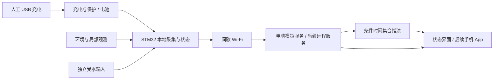

# 下一阶段开发计划书：电池供电的衣架式干燥监测

版本：2026-10-28 / 无太阳能方案。编制依据：用户明确取消太阳能、要求整理下一步计划并同步 GitHub。本文定义计划与验收；动态完成状态只在 [STATUS.json](STATUS.json)，用户要求只在 [PROJECT.md](PROJECT.md)。

2026-10-28 后续授权：用户已要求专用 Terra 对话开始算法实现，由协调者指挥。本计划中“本轮仅规划”指此前计划编制回合；当前 T10 M1 按 [任务书](team/assignments/algorithm-t10.md) 执行，动态状态只读 STATUS。用户随后澄清防水仅考虑充电口，见 [充电口防水设计](WATERPROOFING-DESIGN.md)；其他部位的防水设计与验收移出当前范围。

## 1. 目标与范围

暂定项目名称保持 **基于 STM32 的低功耗衣物干燥监测与远程提醒系统**。

目标是在普通家庭阳台，研究甩干后衣物的干燥状态与条件剩余时间，提供本地受水风险和手机远程提醒。当前为课程设计，使用已有电脑做数学模型、仿真、主机代码和界面演示；不采购、不连接设备、不部署付费或真实云服务。

本次从当前产品范围移除：太阳能板、面板支架/调角、光伏收能与充电选型、板面积/朝向优化及太阳能自供电验收。它们不再是完整预测算法的前置条件。

继续保留：衣物受太阳辐射的热效应、环境/局部温湿度、通风不确定性、面料/初始水量不确定性、慢干区域、本地受水、Wi-Fi 通知及低功耗。**取消光伏供电不等于取消衣物日照输入。**

供电候选改为可充电电池＋人工 USB 充电；这是本轮工程建议，电池化学体系、容量、充电口、稳压及保护器件尚未冻结。USB 不要求晾衣时一直连接，是否可边充边测要由充电发热及防护验证决定。

## 2. 现有基础与真实缺口

| 能力 | 可复用基础 | 下一阶段需要补的内容 |
|---|---|---|
| 局部水汽证据 | T01–T03 短窗口模型、气路比较和误差研究 | 不能直接代表整件衣物水量；需显式观测适配与失配检查 |
| 多周期判断 | T04 身份域、重启/开夹/旧数据隔离 | 接入新预测结果时保持语义隔离，不把弱信号升级成收衣授权 |
| 能量与 C 原语 | T05/T06 完整动作准入、能量账本与主机验证 | 新建无光伏电池情景，人工充电事件、雨情/无线负载及目标内存边界 |
| 通知 | T07 本地持久队列、模拟服务/接收与过期控制 | 新版预测/雨情消息、低电量联动与最小界面；实际手机推送未接通 |
| 数学设计与资料 | T09 两区域方程、参数集合、NASA 历史天气 | 积分器、传感器观测模型和条件时间估计器尚待实现 |
| 衣架形态 | 可移动局部探头、参考探头隔热/通风要求 | 无面板后的主机、电池、探头、雨头布局和取放空间仍需设计 |

现有通过收据仅证明其所覆盖的软件与合成情景，不证明真实衣物准确率、整机功耗、STM32 实机运行或手机送达。

## 3. 调整后的系统分工

- STM32 侧保留观测质量、本地风险和必要状态；较重集合预测先在电脑实现，不能默认装入小 RAM。
- 当前 U031 候选的 12 KB SRAM 与约 20.4 KiB 的既有主机输入加状态基线存在差距，目标编译、流式策略或更大 RAM 选型仍是工作项。
- 本地受水与远程通知分开计延迟。电脑模拟服务不代表可在家外访问；真正远程服务、设备认证和后台推送留待具备部署条件后接入。
- 设备失联、数据过期、安装变化和输入缺失须明确显示；没有新数据不能继续把旧预测显示为当前事实。

## 4. 开发顺序与阶段交付

| 顺序 | 任务 | 交付与完成条件 |
|---|---|---|
| 1 | **T10 完整衣物物理模型与条件时间算法** | 守恒的两区域模型、观测适配、未知参数集合、可重放合成情景和独立验收；本轮规划结束后从此处开始 |
| 2 | **T12 衣架结构与电池供电可行性** | 无太阳能布局图、穿脱/测点约束、电池容量与工作量对照；给 T11 固定输入契约与失败边界 |
| 3 | **T11 预测、雨情、能量、通知和最小界面联动** | 无光伏端到端离线演示；新挂衣/换衣、雨后变化、低电量、人工充电、断网补传与过期提示可重放 |
| 4 | **T08 课程设计总评审** | 需求—实现—证据矩阵、比较结果、报告材料、BOM 及未解决问题；明确未来最少需要的实物实验 |
| 条件阶段 | H01 | 仅当用户以后改变预算与实施条件时开展硬件/真实手机验证 |

T12 的原太阳能研究范围撤销，新范围转到 T10 之后；保留任务 ID 便于追溯。此计划不自动执行这些实现任务，也不把规划完成记作算法完成。

## 5. T10 可直接执行的工作包

2026-10-28 位置澄清：用户指定衣架底部横杆中央为目标接触位置，未接触不开展衣物干燥记录。后续观测适配参考 [中央接触位置研究](CENTRAL-CONTACT-REVIEW.md) 的来源与边界；当前不增加测点或冻结电容/电阻器件。M1 两区域数值模型不意味着两个物理探头，不因本次讨论直接重写；新增建议先说明证据和代价供用户考虑。

**输入边界**：读设计补充 [第 2–6 节及第 12 节](PREDICTION-RAIN-POWER-DESIGN.md)、[T09 来源登记](references/T09-sources.md)、归档 NASA 数据及其来源记录。局部气路接口按需读取。T12 尚未完成时用有来源标记的合成几何/覆盖参数，未知就用范围，不能等待不存在的实物尺寸，也不能写成量产规格。

| 工作包 | 内容与候选文件 | 验收重点 |
|---|---|---|
| T10.1 契约与配置 | `research/garment_prediction/contracts.py`、版本化配置/参数来源 | 干基含水量 kg/kg、温度 °C、辐照 W/m²、风速 m/s、质量 kg、面积 m²；每项区分来源值/假设/未知，拒绝缺失与非法范围 |
| T10.2 前向模型 | `model.py`、`integrate.py` | 普通区和慢区的水分/温度守恒；吸湿/蒸发、负库存与事件边界、自然通风、低温超域、步长收敛及独立求解对照 |
| T10.3 观测适配 | `observations.py` | 显式从状态生成环境/局部可观测量；夹具覆盖不双计面积；传感器延迟/误差与缺失有标记；旧模型仅在其适用域内连接 |
| T10.4 条件预测 | `estimator.py` | 未知面料/初始水量/风/覆盖等参数集合；只用截至当前时刻的可得观测，输出时间范围或未知，不强制唯一分类 |
| T10.5 情景与验收 | `scenarios.py`、`run.py`、检查与 `results/` | 正常/慢区、错误材料先验、初值变化、日照/风/湿度变化、吸湿/再湿、超域和同观测不同含水反例；来源/种子/指纹完整 |

表中是规划时的候选文件名；实际 M1 已将契约和积分归入 model.py/参数登记，当前实现与证据见 [M1 验收](verification/T10-M1-review.md)。后续 M2a 按 [任务书](team/assignments/algorithm-t10-m2.md) 在独立目录建立中央观测和反例，接受后再做 M2b；不在多处维护同一套参数。顺序依赖为 1→2→3→4→5，测试设计可并行准备，但最终验证必须针对已整合的真实实现。

### T10 必须回答的数学问题

1. 质量通量如何进入水量和潜热项，单位是否一致；可变热容/参考焓怎样处理，质量边界的裁剪不能破坏热量账本。
2. 两区域未观测慢区如何限制结论；整件时间取决于所建模区域，并不是单点实测证明。
3. 水活度、内部阻力及材料参数若无实测，怎样保持为明确的合成闭合关系，不能伪称真实棉/聚酯参数。
4. 局部气路与温度模型若无法闭合，就缩小为仅前向物理情景或已定义的观测接口；不直接读取含水真值冒充传感器。
5. NASA 的实际未来天气只能作明确标注的预知参考，不能充当预测当时已知的天气预报。首次在线推演使用持续/变化假设和有时间戳的输入。

### T10 验收矩阵

| 类别 | 必须有的证据 | 失败时的处理 |
|---|---|---|
| 数值正确性 | 水/能量账本、极限、时间步减半与独立参考解；容差在检查前由尺度和数值误差定义 | 缩小步长/模型域或修复方程，不只调门限 |
| 物理边界 | 平衡、蒸发冷却、无太阳仍可干燥、吸湿、零库存、无强迫风仍有自然交换 | 明确拒绝/事件处理，不能用无依据截断掩盖错误 |
| 不可辨识性 | 同观测但不同参数/水量的反例仍保持多解或无法确认 | 保留区间或未知，不报告识别成功 |
| 无信息泄漏 | 估计器输入不含真值/情景标签/未来实际天气；扰动这些隐藏字段不应改变在线结果 | 隔离生成器与估计器，重新生成受影响结果 |
| 结论边界 | 输出模型版本、观测截止时刻、未来条件、范围/无上界原因与合成标记 | 未校准区间不标 95% 置信度；`collection_authorized=false` |
| 复现 | 数据来源/单位/有效域、种子、配置及来源/产物指纹、实际命令 | 源码变化必须重生成，不能继续引用旧图与通过数量 |

T10 的最终产物：`docs/GARMENT-PREDICTION.md`、独立验收收据、带参数来源和运行清单的结果。真实准确率与收衣阈值仍由后续独立实验解决。

## 6. T12 的电池与结构准备

无光伏时，电池预算按实际工作量计算：

`E_available_Wh = C_nominal_Ah × V_nominal_V × f_usable`

`runtime_days ≈ E_available_Wh / E_battery_day_Wh`

只在日耗恒定的假设下使用该近似；正式比较应做逐时账本。电池侧预算若已包含负载转换损失，不再除一次效率。T09 的 0.06/0.13/0.33 Wh/日只能作未实测初始参考，新雨情工作量、休眠漏电与真实无线会话尚未确定。

- 正常晾衣情景 `PV_input = 0`，不能用日出或光照替代充电事件。
- 人工充电仅在显式输入表明已连接时发生；不得用“预期用户会充电”的未来能量准入当前动作。
- 日照只影响衣物热模型/探头误差，不增加电池能量。
- 比较电池容量、测量频率、联网次数与低电量服务缺口；7/14/30 日可作设计比较目标，非用户承诺或已实现续航。
- 检查无线瞬态、压降、充电热干扰、容量随条件变化；平均能量够用不等于电源路径可用。
- 布局保留钩口、衣服穿脱空间、参考探头通风、测点覆盖影响、雨头暴露及可拆/充电操作；没有面板仍需这些检查。

T12 的防水评审仅覆盖充电口的位置、封盖、插拔空间与开/关盖使用条件，见 [充电口防水设计](WATERPROOFING-DESIGN.md)。移除其他部位的防水结构、膜响应、冷凝和防水恢复验收。原有观测质量、雨情区分及充电热影响仍是相应功能问题，不新增自动受水/端口检测硬件。

## 7. 团队任务分派与上下文控制

按用户指定，本轮使用 **GPT-6.1 Terra (`gpt-6.1-terra`)**：机械性盘点/链接/来源核对用 medium；涉及验收边界、数值对照与失败案例设计用 high。协调者保留物理闭合、接口决策、源码整合、全局状态和 GitHub 写入。

前一轮依赖盘点与 T10 准备审查是只读准备；后续 R18 已授权专用 Terra 对话按 [任务书](team/assignments/algorithm-t10.md) 分阶段实现 T10。动态交付/验收状态以 STATUS 为准。

后续 T10 可交给 Terra 的独立任务：参数来源清单、合成情景表、观测输入与真值隔离检查、链接/manifest 完整性审查。数值核心由专用 Terra 对话在独占路径实现、协调者审查；参考求解对照可交给独立角色，但必须冻结输入与验收准则，不能仅复制被测实现作“独立”验证。

每个分工任务只包含：目的、只读输入/指纹、唯一写入目录、完成标准、禁止项和报告路径。依赖尚未稳定时先准备清单，不依赖正在改变的另一路代码。所有角色不得自行提交/推送或派生代理。协作不代替独立证据。

## 8. 历史资料和 GitHub 同步规则

仓库：[`Becauseiloveyo/stm32-learning`](https://github.com/Becauseiloveyo/stm32-learning)，本轮已通过 GitHub 连接及本地 `origin` 核对，默认分支 `master`。

本次同步包含尚未上传的 T09 资料/计算、后续结构讨论记录以及本次无太阳能计划，不能只上传一个计划文件而让链接失效。协调者先检查全部待提交文件、敏感信息、来源指纹和状态依赖，再以普通快进提交同步；不强推、不覆盖远端独立变更。

研究清单校验原始字节。本轮发现 Git 自动换行转换会改变部分历史文件的字节，因此通过 `.gitattributes` 禁止自动转换，并在暂存时保存现有已验收字节；这不是改写历史实验数据或重跑旧测试。推送前从暂存树导出副本，检查恢复工具及 T09 来源/产物指纹。

| 文件/目录 | 当前身份与处理 |
|---|---|
| `PROJECT`、`FEATURES`、`ROADMAP`、本计划、`STATUS` | 当前入口，统一为无太阳能产品范围 |
| `PREDICTION-RAIN-POWER-DESIGN` | T09 原研究；第 2–8/11–12 节仍供参考；光伏供电内容标为历史，最终任务顺序以本计划为准 |
| `HANGER-INTEGRATION-PLAN` | 原含面板结构分析，保留追溯；面板比较已退出，通风/取放/测点/雨头约束迁移到新 T12 |
| `power-notification-design.md`、T05/T06 代码和收据 | 历史已验收输入，保留原字节和哈希；现有收能测试不代表当前产品仍有太阳能。不能静默改 `harvest` 后沿用原结果 |
| `research/design_extension/` 的 PVGIS 与面积计算 | 保留公开来源/结果用于历史复算；不是当前供电规格或下一步的必跑任务 |
| NASA 气象与太阳辐照数据 | 继续支持衣物干燥环境研究，格点数据不是阳台/衣物实测 |
| 团队冻结副本 | 历史派发输入，不作为最新需求；以最新 PROJECT 和 STATUS 恢复工作 |

如果改变能量模型/情景，应在相应后续任务生成新的独立结果和收据；不能删除旧资料以伪造“项目从未用太阳能”。本次仅调整计划与现行说明，没有把旧软件结果重新标成无太阳能验收。

## 9. 风险与完成边界

最主要风险仍是观测不足和模型失配：单个局部温湿度信号未必能确定整件含水量。允许输出宽范围/未知，必须记录无结果比例，不能通过排除困难情景制造准确率。

移除太阳能降低了结构和供电设计复杂度，但不保证判干更准确或续航足够。可检验优势应围绕未知面料下的诚实预测、受水提醒、低能量服务与消息新鲜度，在同样观测/容量/天气条件下比较。

本轮准备完成的标准：当前入口无太阳能依赖；下一任务有明确输入、接口、验收、停止条件和分工；历史证据可复算；GitHub 与审查后的本地提交一致。算法、App 和实物的完成仍按各任务验收，不能被本计划替代。

## 10. 剩余问题与关闭条件

这是任务分解和验收依据，动态状态只记在 STATUS；不把下表当作新功能扩张或完成记录。

| 优先顺序 | 待解决问题 | 现在用电脑可以交付什么 | 必须留待实物的部分 |
|---|---|---|---|
| 1 / T10 | 干燥时间怎样从可得观测估计；未知面料、初始水量、慢干区怎样处理 | 分阶段验收前向模型，再做观测适配、参数集合和条件剩余时间；检验同观测不同含水反例、超域与无信息泄漏 | 真实含水量标签、可收衣阈值、不同面料的误差与校准 |
| 2 / T12 | 电池多大、多久充电、结构能否放进衣架 | 容量与工作量/服务缺口对照、无线峰值约束、主机/探头/雨头占位和穿脱图；仅充电口防水候选 | 电流/峰值、温升、实际空间与充电口受水/插拔验证 |
| 3 / T11 | 突发受水如何提醒，怎样区分高湿、露水、喷溅与下雨 | 独立本地润湿事件与预报风险、时间戳、失效/低电量/缺预报情景，接入预测与消息 | 雨头布置、误报/漏报、实际检测延迟 |
| 4 / T11 | 离家提醒与离线/过期信息如何工作 | 新消息与最小界面、电脑端到端演示、断网补传/失效提示；明确未来远程认证与推送接口 | 真实手机后台送达、互联网服务及无线功耗；当前不部署 |
| 5 / T11→T08 | STM32 资源与长期运行 | 基于已有主机资源记录评估流式/压缩或更大 RAM 候选，列明有限历史回收与持久化方案 | 最终芯片、目标运行的 RAM/实时性与 Flash 掉电验证 |
| 6 / T08 | 课程设计怎样证明优势 | 相同输入条件下比较基线，报告误报/漏报、无结果比例、时间范围宽度、能量与服务缺口；需求—证据矩阵、BOM 与实验清单 | 真实性能优势与专利新颖性尚无证明，不能由合成对照直接推出 |

当前工作顺序保持 T10 → T12 → T11 → T08；H01 受预算与后续授权约束。充电口之外的防水项目是退出范围，不是已经验证完成；不作为这些任务的新前置依赖。
