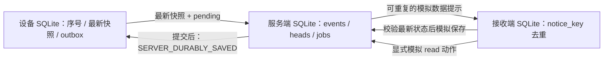

# 离线通知事件契约草案 v0.1

日期：2026-10-23。这是通知角色对 T07 的独立预研，等待 T04 状态机、T05 调度及 T06 C 核心接口后续对齐；**不是已完成的 T07 接口，也不是已接通的手机通知功能**。状态进度仍只以 `STATUS.json` 为准。

输入为 `team/baseline-v1/power-notification-design.md` 第 8、9 节，SHA-256 为 `ad4dc90989e807a277a8b0766114fc0f279064ebc838f222d63e4ef041d62685`。本文件把其中的持久保存、去重、过期、重新绑定和确认分层要求具体化为可重跑的本地假设；没有采购、部署或实测。

## 1. 范围与不变量

实现：`research/notification/protocol.py`，仅 Python 标准库、三个本地 SQLite 存储和显式虚拟时钟。没有网络请求、HTTP 服务、推送 SDK 或 Android 代码。

1. `LOW_SIGNAL_UNCONFIRMED` 及其任意次数的重复均为研究证据，不产生收衣提醒。
2. 只有同时指定 `state=SIMULATED_COLLECTION_ALLOWED`、`authorization=EXPLICIT_SIMULATION_ONLY`、`origin=synthetic_offline_fixture` 的测试输入可进入模拟提醒流程。代码不接受真实收衣授权枚举，也没有自动把算法输出转换成该模拟输入的路径。
3. 设备先原子保存序号、最新状态与待发事件，事务提交后才允许上传。服务端在一个事务中保存事件、最新状态与推送任务，再返回保存确认。
4. 一个重试事件保持同一 ID、内容和失效时间。相同 ID 不同内容、相同状态版本不同事件均被拒绝，整个上传事务回滚。
5. 一次恢复联网的提交必须携带**当前最新快照**和本绑定下待发事件；服务端先确定最新快照，再决定哪些事件仅进入历史。禁止逐条先推送旧事件、最后才上传最新状态。
6. 每次调度和模拟接收显示前，重新检查绑定、当前批次／状态版本、配置和时间。已知过时或过期的事件不能靠重试复活。

这里的“最新”仅指服务端已接收的状态。设备断网后产生但尚未上传的变化无法被服务器推断；过期时间只能限制陈旧时长，不能保证衣物在有效期内不变化。测试保留了这个反例，不能把成功拦截“已知旧状态”扩写成消除了全部过时提醒风险。

## 2. 字段契约

`Event` 是不可变记录。JSON 采用固定字段，SHA-256 对排序后的紧凑 UTF-8 JSON 计算。未知字段／缺字段、非法枚举和类型拒绝；不尝试兼容推断。摘要用于一致性检查，**不构成签名或身份认证**。

| 字段 | 含义、单位与范围 |
|---|---|
| `schema_version` | 整数，当前仅接受 `1`。未来改变字段须明确迁移，不能静默解释成当前版本。 |
| `device_id` | 设备逻辑身份；1–64 个 ASCII 字母、数字、下划线或短横线。不是访问凭证。 |
| `producer_id` | 本次设备持久存储实例身份，同样的字符范围。测试用固定 `fixture_p1`／`demo_producer`；未来由受信任初始化分配唯一命名空间。恢复出厂或存储丢失须换实例并重新绑定。 |
| `binding_epoch` | 服务端分配、从 1 递增的绑定代次。绑定变更后旧代次上报、推送及读确认失效。 |
| `batch_seq` | 同一持久设备实例中从 1 递增的晾衣批次序号；换批次、重新绑定后首次快照都增加。 |
| `garment_session_id` | 派生为 `{producer_id}:batch:{batch_seq}`；不以时间戳作为批次身份。 |
| `event_seq` | 跨重启递增的事件序号，初始化后不回绕、不因绑定改变而清零。 |
| `event_id` | 派生为 `{producer_id}:event:{event_seq}`，相同事件重试不重新编号。 |
| `state_version` | 同一批次从 1 递增；新测量／状态确认形成新版本，纯重传沿用旧版本；新批次从 1 开始。 |
| `boot_id` | 持久开机计数，从 1 递增；重启不改变历史事件里的开机编号。 |
| `monotonic_ms` | 本次开机内的相对时间，整数毫秒、不倒退；跨 `boot_id` 不比较，不用它编造 UTC 时间或跨重启 TTL。 |
| `measured_at_s` | 整数 UTC Unix 秒，指状态所依据的测量／确认时间；没有有效实时时钟则为 `null`，不是上传时间。演示使用虚拟数值 1000 等，绝不是实际测量日期。 |
| `clock_valid` | 严格布尔值；为 false 时必须 `measured_at_s=null`、不确定度为 0。此类事件可排序、保存，但不发收取模拟提醒。 |
| `clock_uncertainty_s` | 时钟误差的双边界，非负整数秒；0 是明确的理想时钟模拟假设，不是实物校时精度。 |
| `ttl_s` | 整数秒，`1..1800`；上限来自冻结基线暂定 30 分钟，尚未验证，后续产品可重新评估。 |
| `state` | 当前仅接受 `RESEARCH_WET`、`LOW_SIGNAL_UNCONFIRMED`、`UNKNOWN`、`MONITORING_PAUSED`、`SIMULATED_COLLECTION_ALLOWED`。这些是协议测试枚举，尚非 T04/T06 的正式映射。 |
| `authorization` | 通常为 `NONE`；只有模拟可收取状态要求 `EXPLICIT_SIMULATION_ONLY`。给弱信号附带该值也会被拒绝。 |
| `episode` | 从非模拟可收取状态进入模拟可收取时增加；同批次连续的重复确认沿用此编号。用于避免同一轮持续状态反复弹出提醒。该规则需状态机确认。 |
| `config_version` | 已应用的配置版本，整数 ≥1；只有与本绑定服务端要求版本相同的事件可进入提醒。当前未实现远程配置传输。 |
| `origin` | 固定 `synthetic_offline_fixture`，避免测试记录冒充真实测量。 |
| `algorithm_version` | 固定 `unintegrated_research_v1`，明确未对齐主算法。 |
| `quality_reason` | 默认 `synthetic_input_no_garment_calibration`，只作研究来源说明，不能当真实质量等级。 |

整数均排除布尔值并限制在非负有符号 64 位范围；表内声明从 1 起的字段不能为 0。时间加法、序号上限触发错误后停止提交，不回绕。后续 C 端还需确定序列化字节序、最大报文、CRC、Flash 双页或日志实现及溢出处理；SQLite 不代表 MCU 的存储实现。

`notice_key = device_id : binding_epoch : garment_session_id : episode`。事件 ID 用于上传去重，通知键用于接收端提醒去重，二者不混用。新版本仍处于同一 episode 时，接收端静默更新模拟卡片，不再添加一条提醒；新一轮明确退出又进入才有新通知键。未展示过但过期的事件必须以新事件重新确认，重传自身不能延长期限。

## 3. 时间判断

原型假设服务端虚拟 UTC 时钟可信、非递减且持久化；重启后输入时间倒退会拒绝操作，等待明确修复。它不实现现实中的校时协议。

对时钟有效、测量值为 `m`、误差界为 `u`、有效期为 `ttl` 的记录：

- 首次入库须满足 `m + u <= server_now`，否则永久作为 `future_or_uncertain_at_ingest` 历史记录。等待时钟走到该日期后重传也不激活，须产生新的确认事件。
- 采用保守截止 `expires_at_s = m + ttl - u`，从最早可能测量时间算有效期。
- 只有 `server_now < expires_at_s` 才可能提醒；**等于截止时刻已过期**。
- 上传、推送重试、服务端重启、接收端重启都不重置测量时间或截止时间。
- 无有效 UTC、无法给出可信误差界或时间源失效时，顺序仍可由序号保留，但不补发收衣模拟通知。服务端接收时间不能替代测量时间。

实际实现还需解决设备校时、时钟漂移、异常跳变、时间不确定度来源以及多服务实例的时间一致性。模拟未证明这些条件在硬件上成立。

## 4. 本地持久化和事务



全部连接使用 `journal_mode=DELETE`、`synchronous=FULL`，写操作使用 `BEGIN IMMEDIATE`。设备、服务端、接收端分别存储，故意不把跨端操作放在同一数据库事务里。

| 本地存储 | 关键表及含义 |
|---|---|
| 设备 | `device_meta` 保存序号、开机号、批次、episode 与最新快照；`outbox` 保存事件原文与 `saved_ack`。二者一次事务更新。 |
| 服务端 | `bindings` 是模拟授权注册表；`events` 是不可变事件；`heads` 是每设备当前绑定最新快照；`jobs` 是持久任务；`push_attempts` 单独记载模拟推送接受；`service_clock` 保存已观测时间下界。 |
| 接收端 | `receiver_owner` 固定模拟所有者；`notices` 以 `notice_key` 为主键，保存当前卡片、首次模拟提醒时间、已读和失效字段。 |

设备提交事务失败则序号与事件一起回滚；未提交的序号可能在下一次内部生成中复用，但此前从未对外传输。已经提交并可能对外传输的事件 ID 不会因正常重启复用。

服务端按 `(batch_seq, state_version)` 比较快照；批次序号优先，所以新批次版本 1 不会被旧批次版本 10 覆盖。更早包可补历史，不能回滚 `heads`。`event_seq` 与快照顺序矛盾拒绝；相同状态槽冲突回滚。单个提交中的最新快照不能落后于任何待发事件。

新快照到达会取消待发旧任务。调度前再检查，解决保存后又变更的窗口；接收端显示前再次检查，解决已经出队但后来才到达的数据提示。`events.ingest_reason` 只表示首次入库理由；任务的当前状态以 `jobs.status/reason` 为准，不能把首次可用当成持续可用。

原型只模拟串行调度和一个接收端。它没有跨网络的端到端 exactly-once 保证：服务端可能重复尝试发送，接收端通过持久通知键实现本地提醒去重。真实 OS 展示动作与本地数据库提交无法靠这个模拟自动合并成事务；仍需稳定通知 ID、平台测试及崩溃恢复设计。

## 5. 确认含义与失败处理

| 确认或观测 | 原型中成立条件 | 不代表什么 |
|---|---|---|
| `SERVER_DURABLY_SAVED` | 服务端事务提交后返回设备身份、绑定代次、`saved_hashes` 和 `acknowledged_at_s`；设备核对完整事件摘要后标记 outbox 已保存 | 不表示任务一定可推送，也不表示手机收到或用户阅读；仅历史保存也会确认 |
| `SIMULATED_PUSH_ACCEPTED` | 在 `push_attempts` 中保存一次本地模拟通道接受；可能重复多次 | 不是实际推送服务回执，不是手机展示 |
| `SIMULATED_RECEIVER_SAVED` | 模拟接收端通过最新状态检查后，已保存通知键及卡片 | 不是真机或 OS 展示证据，不代表用户已读 |
| `DUPLICATE_SUPPRESSED` | 接收端已保存同一通知键；相同事件不重复展示，更新事件只静默刷新 | 不能伪造新提醒次数 |
| `user_read_at_s` | 测试明确调用 `Receiver.read`，且已有有效的接收确认；重复读确认不改变首次时间 | 不是真人看过，更不代表衣物已收取 |

`events.saved_at_s` 保留首次保存时间；重复保存确认的 `acknowledged_at_s` 是本次确认时间。设备收到保存确认即可停止该事件的上传重试，不能等待用户已读才清除待发标志。

服务端重试使用确定性的 `[60, 300, 900, 3600]` 秒间隔，之后按最后一项；到期后优先取消，绝不因手机恢复而延长 TTL。无随机抖动，随机种子为 `null`（没有使用随机数）。这是测试用服务端调度参数，不是设备无线重试策略，也没有射频耗电或每日能量预算保证。设备单次联网超时、每日重试能量上限须接入 T05。

| 情景 | 处理 |
|---|---|
| 保存前进程中断 | SQLite 恢复后，事件、head、job 均未提交；设备继续重试。 |
| 保存后确认丢失 | 设备仍保留待发记录；同 ID 同内容重试只返回保存确认，不新增任务。 |
| 模拟推送接受后中断 | 保留尝试次数和下次时间；接收状态为空，后续可重试。 |
| 接收端保存后服务端中断 | 接收端已持久去重；服务端下次重试获得去重回执，不新增提醒。 |
| 断网期间状态变化 | 恢复上传最新快照后，旧模拟可收取事件只存历史，撤销未完成旧任务。 |
| 已显示后状态变更 | 模拟接收端再次可达并 `sync` 时标记旧卡片失效；不能保证撤回手机离线期间已存在的 OS 通知。 |
| 手机不可达 | 可有模拟推送接受记录，但接收和已读保持空；按计划重试、按原截止失效。 |
| 时钟无效／未来时间／过期 | 只存历史，不创建有效提醒任务；旧时间不能重传“刷新”。 |
| 配置版本改变 | 立即取消旧配置任务；设备必须新建已应用新版本的确认事件。配置传输本身未实现。 |
| 重新绑定 | 服务端增加 epoch 并清除当前 head；旧任务取消、旧上报与旧接收者拒绝；设备保存新 epoch，下次事件新建批次。旧 outbox 保留本地审计，不能上传给新所有者。 |

## 6. App 显示契约及待接入字段

未来 App 须分别显示“最近测量／确认时间”“最近与服务端通信时间”“该数据的年龄／是否过期”，以及研究状态和原因。时钟无效显示“测量时间未知”；只知道模拟推送接受时不能显示“已送达”。重新绑定后旧所有者不得拉取当前状态，历史访问和数据移交政策需另行确定。

当前原型的通知卡片只有持久数据记录，没有 UI。其显示文案须含“模拟／研究”、测量时间和截止时间；若显示状态已失效，不能保留为当前收衣建议。接收数据提示后取最新状态失败时不创建收取提醒。实际手机后台是否能完成这一步尚未验证，若采用系统直接显示的通知消息，可能绕过校验，需要另行设计。

以下字段仅为后续接口需求，**不声称已实现**：

- 测量摘要的真实质量等级、原因码、算法版本和独立标定授权引用；不得复用模拟授权字符串。
- `ambient_T/local_T`（摄氏度）、`ambient_RH/local_RH`（%RH）及缺失／有效范围；由测量契约提供，不在通知层重复推断。
- `battery_level_band`、`charging_state`、`energy_mode`、暂停原因；由供电／状态机定义。
- `firmware_version`、`next_report_due`、允许宽限、最近成功通讯时间；当前只有事件首次保存时间，不应据此声称最近一次重传通信时间。
- 远程配置待应用／已应用版本、配置有效期与失败确认。
- 真实设备和 App 的身份认证、TLS、密钥更新、绑定授予／撤销、订阅端映射、读历史授权。

## 7. 验证入口和剩余限制

从项目根目录运行：

```powershell
python -B -X utf8 -m unittest discover -s research/notification -p test_protocol.py -v
python -B -X utf8 research/notification/run_checks.py
```

第二条只在本角色 `research/notification/results/run-*` 新建证据目录，保存测试逐项日志、源码／冻结输入指纹、虚拟情景、三个 SQLite 示例及其摘要；不会写主测试记录。运行 `run_checks.py --verify <receipt.json路径>` 检查证据与当前输入是否仍一致；这项验证不会重新运行测试。

检查包含异常注入与实际子进程 `os._exit(73)` 的事务恢复、两端重启、重复／冲突／乱序、批次切换、到期边界、无效／未来时钟、绑定／配置改变、不可达接收端以及弱信号拒绝。最终数量与结果以本轮报告及其 receipt 为准。

未覆盖：物理断电、Flash 耐久／CRC／坏块、磁盘满和故障介质、持久存储回滚／克隆、队列容量与清理政策、多个设备／接收者／并发推送 worker、真实网络的重排与安全攻击、服务端集群事务、手机系统通知和后台限制、真实时钟误差、用户读确认的离线重试、设备重连能量。此原型没有真实认证安全性或后台送达率证据。

正式接入前需由协调者在 T04/T06 之后冻结状态映射、批次／episode／授权边界、单写者规则、时间有效性、掉电存储格式和能量调度接口，再按 T07 验收。这里的模拟成功不能绕过前置任务。
