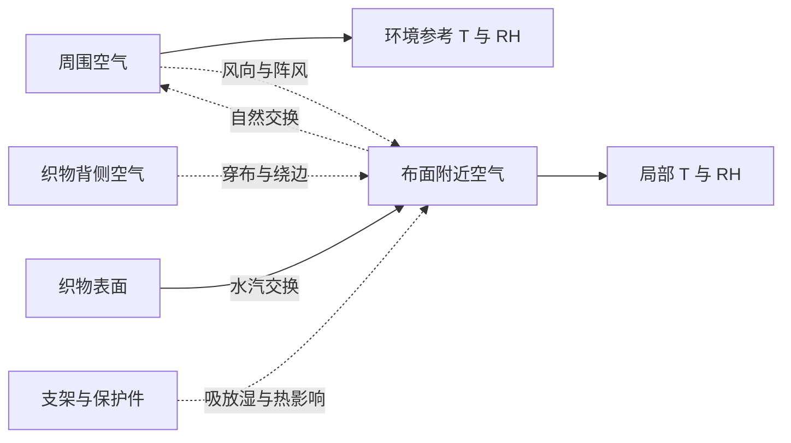
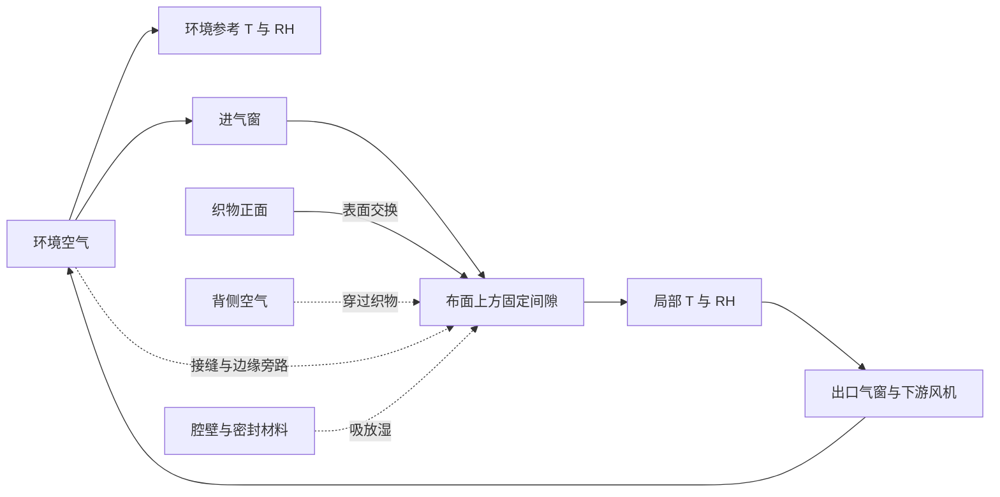
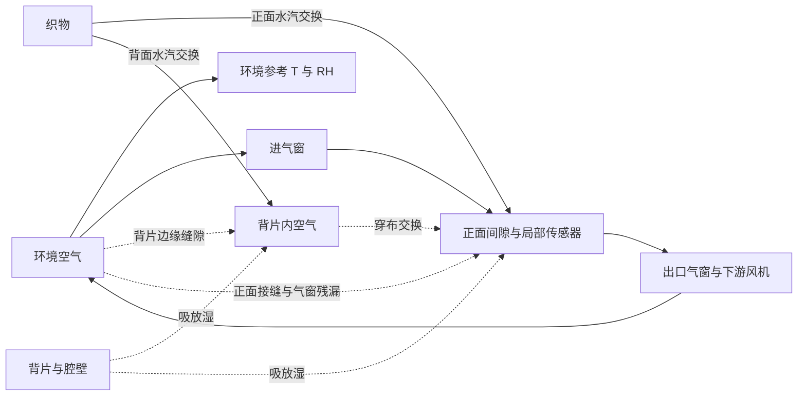

# 三种采样结构：T02 候选比较与协议接入

更新：2026-10-24。本文件是 T02 角色交付，已接入验收后的 [T01 测量契约](MEASUREMENT-CONTRACT.md)，待协调者验收主线。保留首轮 [冻结基线 v1](team/baseline-v1/snapshot.json) 的结构推导和独立数据；新增接入口及本轮证据见 §6–7。T03 草案仍为预研，当前没有硬件实测。原始资料核查沿用 2026-10-23 的 [来源登记](../research/probe/sources.md)，本轮没有增加外部性能参数。

建议保留开放布点作为被动对照，以可拆卸背片的单面气窗腔体作为下一阶段优先研究载体。背片是否保留取决于它能否约束背侧交换，同时不过度改变被测位置的干燥。没有证据把三种结构排出实物性能名次；若关键歧义仍无法约束，应缩小用途为局部趋势观察。

## 1. 比较的是哪些结构

图中实线表示拟定的受控换气路径或布面交换，虚线表示未受控路径／扰动，不表示已测到的流量。参考探头放在与局部头具有可比遮阳条件、又不直接吸入其排气的位置；具体距离未知。可控的是位置、几何和命令，真实气量仍须验证。

### O：开放布点



- **可控量**：探头离布距离、朝向、固定位置、遮阳与支架面积；可记录重夹。没有独立关窗恢复阶段。
- **观测量**：两处 T、RH、时间、安装事件；环境参考并不等于局部迎风侧空气。
- **漏风与未知量**：这里不是密闭腔漏气，而是开放局部空气交换。有效 V、混合程度、K、等效 Q 随风和布面形状变化，不能将 5 mL 假定为真实开放体积。
- **壁源**：虽无腔壁，附近支架、保护罩、PCB 或残留液滴仍可能产生历史相关扰动；大小未知，不能直接记零。
- **覆盖干扰**：面积可能较小，但支架会遮光、挡风，夹持可能压布或改变间距；“开放”不等于无干扰。
- **不利反例 O1**：在同一假设 K 下，Q 很大使湿样表面的分压差趋于零（§3）。O2 是共同环境变化下的响应失配（误差草案 §3），即使两处真实水汽压相同也能出现差分峰。
- **用途／否决条件**：作为同探头、同批次的被动基线保留。若信号依赖未约束的风向／距离，不能据此授权收衣；不能用腔体恢复模型反算开放结构的含水量。

### C：带气窗的单面腔体



- **可控量**：名义腔体、间隙、开口、夹持面积／压力、气窗命令及持续时间、风机命令。恢复阶段关闭受控进出口，但残余交换不为零。基线 2／5／10 mL、2–5 mm 只是未来几何对比起点。
- **观测量**：两处 T、RH、阶段、开夹；气窗位置或流量只有增加独立反馈后才能称为实测。本轮只有假设 Q_u。
- **漏风与未知量**：织物本身不是密封壁。跨织物、边缘、接缝、气窗均可交换；PWM 不等于 Q_u。风还可能改变 K，不能只改 Q_l。背侧空气若与环境参考不同，不能全部合并为通往同一 e_a 的漏风。
- **壁源**：腔壁、胶与密封接触面积增加，可能在换气后继续释湿；空腔或不透水替代片的控制实验须保留预湿历史，且不能直接代表真实布装夹的全部气路。
- **覆盖干扰**：改变局部湿度、遮光和换热，夹持可压缩组织；受控吹气也可能让局部提前干。有效面积和 K 可能与无覆盖样不同。
- **不利反例 C1**：§3 的“同 A、B”参数对经过任意同样的已知 Q_u(t) 仍不可区分；C2 为壁源替代表面水汽来源的精确同曲线反例。更多风机档位不能单独解决它们。
- **候选依据／否决条件**：能固定部分几何、做开窗／关窗及空白对照，适合作为可解释性研究载体。若装夹间漏风差、空白恢复或热瞬态已覆盖待判信号的尺度，停止用恢复特征判干；先约束干扰或退回被动用途。

### B：单面腔体增加背侧挡风片



- **可控量**：增加背片间隙、范围、边缘形式、开闭时间；其余同 C。背片必须作为可撤除的对比变量，不预设为最终零件。
- **观测量**：与 C 相同；背侧空气 e_b、T_b 在双探头配置下没有被独立观测。若需要研究它，必须另提接口，不能把模拟真值混进算法。
- **漏风与未知量**：可能减小直接穿布风扰，但也可能留下绕边通道，改变局部压力，或形成第二储湿体积。实际 Q_l、e_b、连通程度及随阵风变化均未知。没有测量依据给 B 分配比 C 更小的漏风。
- **壁源**：增加材料和滞留空间，历史效应可能增大，也可能不显著；两者都未验证。前后空腔若不充分连通，不能简单加总体积代入一个混合腔。
- **覆盖干扰**：双面局部覆盖可降低通风蒸发或改变温度；信号增强可能只是局部被延缓干燥。后背片也可能积滴、接触布料或改变夹持压力。
- **不利反例 B1**：即使假设交换变小，§4 的双面通风算例显示它可以同时明显减少局部瞬时蒸发。B2 是小 K 情景：固定 a_w=1 而 K 降至假设的 0.002 mL/s，90 秒窗口恢复幅度仅 33.16 Pa；这不是含水少的证据。C1／C2 同样适用。
- **候选依据／否决条件**：作为 C 的可拆卸比较件保留。只有独立证据同时支持气路更可重复、壁源可控制及覆盖影响可接受，才考虑保留。若收益仅来自人为指定更小 Q_l，或背侧湿度不可解释、覆盖影响超过预先约定容限，则不选它作为判干结构。

## 2. 结构参数不能靠假设排出性能名次

| 参数／条件 | O 开放 | C 单面气窗 | B 背侧挡风 | 本轮处理 |
|---|---|---|---|---|
| 有效空气体积 V | 无明确封闭边界 | 几何可量，死区未知 | 前后可能两个体积 | C／B 单腔极限算例用 2、5、10 mL；O 仅作等效反例 |
| 漏风或自然交换 Q_l | 随风、距离变化 | 穿布＋绕边＋气窗 | 增加背侧边缘及第二环境 | 三者真实区间均未知；不设置“结构专属较优值” |
| 受控交换 Q_u | 无 | 命令可控、实际气量未知 | 同 C，背片还可能改变压差 | 本轮沿用假设流量，不输出 g/h |
| 壁源 S_w | 支架／保护件未知 | 腔壁与密封未知 | 新增背片历史未知 | 共用敏感性区间及同曲线反例 |
| K、a_w、表面 T_f | 未知 | 覆盖后可能改变 | 双面覆盖后可能改变 | 不将 a_w 当衣物含水率 |
| 传感器 τ、热偏置 | 安装决定 | 气路／死区／PCB 共同影响 | 同 C，另有背侧储湿 | 4、30、120 s 仅为分析点 |

## 3. 参数敏感性与可复现反例

在近似等温、单腔充分混合、环境恒定、参数固定且无凝露的前提下，令 y=e_c−e_a、D=K+Q_l+Q_u、B=K(e_*−e_a)+R_v T S_w：

```text
V dy/dt = B − D y
y_inf = B/D                 tau_c = V/D
dy_inf/dQ_l = −B/D²          dy_inf/dS_w = R_v T/D
dy_inf/dK = [(e_*−e_a)(Q_l+Q_u)−R_v T S_w]/D²
dy_inf/dV = 0               dtau_c/dV = 1/D
```

这里 K、Q 均为 m³/s，S_w 为 kg/s，T 为 K。稳态式只在其结果仍未饱和时有物理解释。V 不改变此模型的稳态值，但改变固定时长窗口；因此“小腔体信号一定更强”也不是无条件结论。传感器满足 τ_s dz/dt=y−z，τ_s 影响有限窗口而不改变常输入下最终值。

固定 a_w=1、25 °C、60% RH、K=0.02 mL/s、V=5 mL、S_w=0、τ_s=4 s；采用冻结基线的 30 s 基线＋20 s 换气＋90 s 恢复、1 s 采样，无随机噪声。恢复幅度为最后 11 点均值减最初 6 点均值。下面保留首轮独立脚本的历史结果，T02 已按同条件重新核对；它们不同于主模型默认含噪声的示例。

| 假设 Q_l，mL/s | 恢复幅度，Pa | 尾部差分，Pa |
|---:|---:|---:|
| 0.005 | 323.00 | 353.96 |
| 0.02 | 284.22 | 314.59 |
| 0.1 | 156.10 | 183.74 |
| 0.5 | 29.17 | 48.63 |
| 1.5 | 5.37 | 16.64 |

开放布点 O1 的稳态反例直接由 y_inf 得出：a_w=1 不变，Q_l=1.5 mL/s 时 y_inf=16.64 Pa；Q_l 趋于无穷时 y_inf 趋于零。表内周期只是有腔控制体算例，不能作为开放探头的实际周期。它也不预测任何风速对应哪一行。

在名义点，只改变假设 S_w 为 0／0.02／0.10 µg/s，恢复幅度分别为 284.22／315.14／438.83 Pa。只改变 τ_s 为 4／30／120 s，恢复幅度为 284.22／194.73／78.23 Pa。壁源能增强“来源”特征，慢响应能压小短窗口特征，但都不等同于衣物状态变化。

**精确同曲线 C1。** 冻结基线已给出 K=0.02、Q_l=0.02、a_w=1 与 K=0.04、Q_l=0、a_w=0.8 两组（流量单位 mL/s）。在环境 RH=60% 且壁源为零时，两者 K+Q_l 和 K(a_w−0.6) 相等。给同样 Q_u(t) 与初始条件，方程及一阶传感器输出相同。首轮独立解最大数值差为 2.27×10⁻¹³ Pa；T02 主模型重放见 §7。

**精确同曲线 C2。** 固定 K=Q_l=0.02 mL/s，把 a_w 从 1 降为环境平衡的 0.6，同时令：

```text
S_w = K × (1−0.6) × e_s(25 °C) / (R_v × 298.15 K)
    = 0.1838269058 µg/s
```

B、D 不变，因此整段命令和观测仍相同；首轮独立解数值差为 0 Pa，T02 主模型重放的浮点差见 §7。这是人为构造的源项等价，不是已测到这种材料放湿率；“表面水汽势与环境相同”不等于整件衣物干态。需要独立空白、材料历史或额外观测才可能区分来源。

首轮全网格为 3 种 V×5 种 Q_l×3 种 S_w×3 种 τ_s，共 135 组，三种结构共用不确定参数空间。140 秒短窗口均未越出无凝露计算域；其中 9 组的形式稳态超过饱和边界，已标记，不允许向该稳态外推。T02 在两个协议各重放这 135 组，结果见 §7。正式物理运行范围仍未知。

## 4. 覆盖干扰的完整解析反例

用两个互不耦合的表面气层作最简反例：每面表面水汽势相同且固定，传质 K_i 固定，环境 e_a 固定，无壁源、无热变化。在每面气层稳态，K_i(e_*−e_i)=Q_i(e_i−e_a)，因此该面水汽质量流率为：

```text
J_i = [K_i Q_i/(K_i+Q_i)] × (e_*−e_a)/(R_v T)
J_total = J_front + J_back
```

假设每面 K_i=0.02 mL/s；由这个方程得到：

| 纯假设状态 | 正面 Q，mL/s | 背面 Q，mL/s | 相对瞬时稳态蒸发量 |
|---|---:|---:|---:|
| 双面交换均较通畅 | 0.4 | 0.4 | 1.0000 |
| 只限制正面交换 | 0.02 | 0.4 | 0.7625 |
| 两面交换均被限制 | 0.02 | 0.005 | 0.3675 |

这说明降低交换既可能增大局部分压，也可能抑制局部蒸发；它是对“更封闭必然更有代表性”的反例。数字没有来自三种实物结构的对比，不能称为背片降低了多少干燥速度，更不能用倒数预测干燥时间。真实布内输运、热量、双面耦合、液态水转移和 K 变化均未建模。

## 5. 候选选择与停止条件

| 下一阶段候选动作 | 选择依据 | 否决或退回条件 |
|---|---|---|
| 保留 O 作被动对照 | 能区分结构／主动采样是否提供额外信息 | 风向、重夹和参考位置变化无法约束时，只保留局部趋势用途 |
| 优先研究 C，背片可拆 | 部分几何与操作可复现，可拆分空白、开窗、关窗效应 | 同批次主动结果不能比被动结果改善有效信息；或漏风、壁源、热效应与信号同尺度 |
| B 作为 C 的配对变体 | 可单独检验背侧风扰假说 | 没有独立漏风证据；形成未建模背侧储湿；覆盖对照显示不可接受的干燥干扰 |

“不可接受”应在未来实验前用任务目标、参考不确定度、允许延迟与覆盖率定义，不把当前演示阈值当验收数值。如果所有候选都保留不可区分性，下一动作是约束漏风／壁源、增加独立参考，或收窄安装和适用场景；不能靠反复弱信号、调低漏风假设或模型复杂化产生收衣授权。

## 6. T01 接入与历史映射

[t02_replay.py](../research/probe/t02_replay.py) 只读导入已验收的 `theory`，从 `verification_protocols()` 选择默认和 `three_second_long`。没有另建可编辑默认时序。物理基值取自 `Parameters`，主比较只把噪声设为零；明确的压力变体与共同网格沿用首轮清单。门限直接使用 `DEFAULT_GATES`，不在研究目录调整。

| 首轮实现／记录 | T02 映射 | 核对边界 |
|---|---|---|
| `analyze.py::cycle` 固定阶段和 141 点 | 新入口用协议总时长、采样周期与 `phase_at` | 首轮函数原样保留，仅作历史证据；新入口不调用它控制时序 |
| 固定 50–55、130–140 s 特征窗 | 协议恢复起点＋首窗长度、总时长−尾窗长度 | 端点包含，窗口不随样本移动；默认结果与旧表逐项对照 |
| 背景／换气额外交换量 | 当前 `Parameters.passive_extra_ml_s`／`flush_extra_ml_s` | 流量是物理假设，不放进协议时长配置 |
| 独立分压差解析步进核 | 只复用其数学核；新入口按每个阶段起点直接求时刻解 | 不调用主模型积分核；与主模型绝对水汽压解逐样本比较 |
| 无观测元数据的旧 CSV | 新模拟生成契约 1.0 字段、单位及协议指纹 | 不给旧数据盲目贴新标签；旧 CSV 只用于数值回归 |
| 研究真值和导出分压差 | 另存研究轨迹；判定输入只保留 11 个契约必填字段 | 参数、场景标签、`synthetic_true_*` 和 `delta_e_Pa` 不传给判定 |

本轮两协议的生成快照如下，供审查，配置入口仍在 `theory`：

| 协议 | 基线／换气／恢复，s | 采样，s | 首窗实际时刻，s | 尾窗实际时刻，s | 各阶段点数 |
|---|---|---:|---|---|---|
| default | 30／20／90 | 1 | 50–55，共 6 点 | 130–140，共 11 点 | 30／20／91 |
| three_second_long | 24／18／120 | 3 | 42、45、48 | 150、153、156、159、162 | 8／6／41 |

切换时刻观测属于新阶段，其命令影响之后的积分区间；终点保留。协议完整字段与 SHA-256 在 [protocol-mapping.json](../research/probe/results-t02/protocol-mapping.json) 和 [T02 manifest](../research/probe/results-t02/manifest.json)。非默认观测错传默认协议时拒判。另用小数采样、不同流量、相等时间常数及仅改变首尾窗的测试确认没有遗留旧窗口硬编码。

独立解析比较限定恒定环境、无偏置、无事件、零噪声；不支持的激励会报错，不会被静默忽略。本轮没有扩展热模型、双腔模型或多周期状态机。

## 7. T02 重放证据与结论变化

共重放 16 个代表周期、270 个共有包络点，另设 2 个刻意超域情景。以下是主判定器读取合法无噪声观测的结果；“来源明显”只表示可见水汽来源，不能判断来自布还是壁面。完整值见 [case-summary.csv](../research/probe/results-t02/case-summary.csv)。

| 情景 | 默认恢复幅度／尾值，Pa | 默认研究状态 | 非默认恢复幅度／尾值，Pa | 非默认研究状态 |
|---|---|---|---|---|
| 名义表面源 | 284.22／314.59 | 来源明显 | 347.45／380.44 | 来源明显 |
| 大漏风 | 5.37／16.64 | 弱信号未确认 | 4.98／16.64 | 弱信号未确认 |
| 环境平衡表面，无壁源 | 0／0 | 弱信号未确认 | 0／0 | 弱信号未确认 |
| 环境平衡表面＋匹配壁源 | 284.22／314.59 | 来源明显 | 347.45／380.44 | 来源明显 |
| 同 A、B 的另一参数组 | 284.22／314.59 | 来源明显 | 347.45／380.44 | 来源明显 |
| 30 s 传感器 | 194.73／240.20 | 来源明显 | 269.38／316.33 | 来源明显 |
| 120 s 慢响应压力点 | 78.23／133.82 | 条件不明 | 126.42／182.51 | 来源明显 |
| 小 K 压力点 | 33.16／36.27 | 弱信号未确认 | 42.33／45.71 | 条件不明 |

首轮默认无噪声数字保持一致。协议改变使慢响应和小 K 情景跨过未标定的演示门限，说明特征和研究状态依赖观察窗口；不能因此声称长协议更准确或小 K 不再有歧义。大漏风仍能掩盖 a_w=1 的表面源。匹配壁源和非唯一参数对在两协议中均保持相同观测，最大差不超过 1.82×10⁻¹² Pa。所有判定的 `collection_authorized=false`。

跨模型比较采用完全相同参数和零噪声；在所有 286 个域内周期／包络点，真实差分最大误差 2.51×10⁻¹² Pa，观测差分最大误差 2.35×10⁻¹¹ Pa，首尾特征最大误差 2.19×10⁻¹¹ Pa（数字向上取便于审查的界）。这些只说明计算实现相符，不能证明真实衣物满足方程。验算容限为 10⁻⁸ Pa，属于数值比较尺度，不是传感器精度。

另外保存了一份主模型真正默认含噪声参考：[noise-reference.json](../research/probe/results-t02/noise-reference.json)，噪声为每探头 0.10 RH 百分点、种子 20261023。名义情景幅度为 285.2619 Pa、尾值 314.0371 Pa；相同条件的无噪声值为 284.2185、314.5892 Pa。差别来自这一固定噪声实现，不能拿它与解析解作精确相等比较，也不能把一次随机实现当误差分布标定。

共同包络仍为 V=2／5／10 mL，Q_l=0.005／0.02／0.1／0.5／1.5 mL/s，S_w=0／0.02／0.1 µg/s，τ_s=4／30／120 s；在每个协议各 135 点。两个协议共 18 个形式稳态越出单温度无凝露域，但所有 270 个有限窗口未越域，仍须分别遵守观测质量门限。它们不是三种实物的参数估计或性能排名。

另用明确标记的 S_w=0.5 µg/s、V=2 mL、Q_l=0.005 mL/s 压力情景检查域处理；这没有材料证据。默认首个越域采样时刻为 81 s，非默认为 75 s（采样网格不同，不能当精确物理凝露时刻）。两求解器均拒绝继续作为无凝露过程解释；输出 `not_applicable`、空特征，不剪裁，不把残段传给判定。清单中的 `NOT_APPLICABLE` 是研究产物域状态，并非主判定器新增状态。见 [domain-summary.csv](../research/probe/results-t02/domain-summary.csv)。

## 8. 可操作的研究选择与独立观测缺口

| 结构 | 下一阶段可执行的对比选择 | 必须独立约束的关键歧义 | 即使通过仍不能确定 |
|---|---|---|---|
| O 开放 | 固定相对位置、支架、遮阳；同探头作被动对照，记录重夹和参考位置交换 | 局部与参考空气的空间差、风向／距离影响、安装响应；支架干湿历史空白与覆盖对照 | 没有已知封闭 V；局部分压不能唯一映射整件含水量 |
| C 单面气窗 | 相同几何先比较被动／主动，再做空白历史和装夹重复；执行命令与反馈分开记录 | 独立交换／流量证据、气窗残漏、穿布与绕边的分量；已约束传感器 τ 下的空白恢复、材料放湿；有／无覆盖参考 | 不透水替代面不能代表穿布漏风；空白低信号不能单独标定衣物 K 或 a_w |
| B 增加背片 | 在 C 上只增加可撤背片，配对比较；保持其余材料、几何和观察条件可比 | 背侧空气温湿度或等效独立诊断、背侧边缘交换；重夹／风向重复；两面覆盖影响和材料历史 | 背侧未跟随环境时不能压成单一 Q_l；减小波动不自动证明代表性或真实抗风范围 |

上述是后续验证设计，不是本轮购买或试验执行要求。C 作为研究载体优先，只因可拆分对照和固定部分几何；O 保留为必要对照，B 在双面覆盖／背侧储湿证据出来之前不选为固定结构。几何尺寸、材料、执行器和容限均未冻结。

若三者都不能将未知气路、壁源和覆盖扰动约束到预先定义的决策余量内，则停止追求当前双探头方案的整件收衣判断。缩小为固定安装、受控遮阳和稳定环境内的局部分压趋势研究；报告有效观测、局部来源明显或未确认状态，保留反例和无结果比例，继续保持收衣授权为 false。增加次数或换一套阈值不补足独立证据。真正的温湿风范围、覆盖容限与整件参考标准留待实测，不从本轮网格认定。

## 9. 复现与交接

从项目根目录运行，无第三方依赖：

```powershell
python -B -X utf8 research/probe/t02_replay.py
python -B -X utf8 -m unittest discover -s research/probe -p test_t02_replay.py -v
python -B -X utf8 research/probe/t02_replay.py --verify
```

生成只写 `research/probe/results-t02/`。`--verify` 只读核查 30 个输入、2 个新源文件、8 个产物指纹，重放保存的 16 份合法观测，并重新计算比较全部新产物。14 项本角色检查通过，不混入主线既有 37 项收据。JSON 观测保留数值和布尔类型，判定接口不读取 CSV 字符串或模拟真值。

首轮 [analyze.py](../research/probe/analyze.py)、[历史 manifest](../research/probe/results/manifest.json)、7 个 CSV 和 [第一轮报告](team/reports/probe.md) 均未改；它们是带日期的独立证据，不作为另一套当前时序配置。T03 [误差草案](MODEL-VALIDITY-DRAFT.md) 未改。当前交付见 [probe-t02 报告](team/reports/probe-t02.md)。正式验收与是否推进 T03 由协调者决定。
