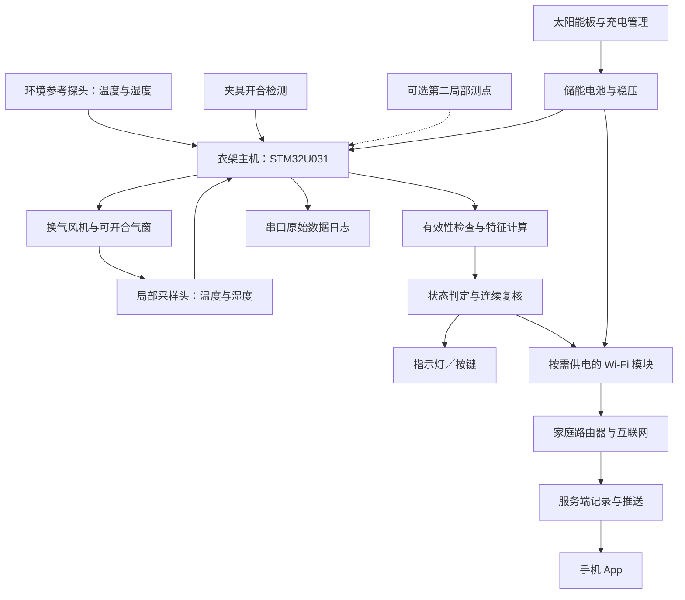

**衣架式干燥状态监测：架构与验证方案**

编制日期：2026-10-23，版本 v0.3。用途：个人 STM32 作品的技术选型和原型路线。

当前阶段：用户暂不采购设备，优先开展理论开发。已建立 [数学推导、仿真与算法边界](theory/README.md)，可完全在电脑上运行。下面的硬件路线保留为未来预算允许后的验证方案；仿真不能代替实测。

已确认场景：有阳光的阳台、家中有 Wi-Fi，手机离家后仍需收到收衣提醒。新增的太阳能、电池、远程通知和能量计算见 [供电与远程通知设计](power-notification-design.md)。本文负责测量方法；配套文档负责供电和消息链路。两者都需要实测闭环。

本方案没有硬件实测结果。器件能力和相关研究来自文末链接；结构尺寸、时序、预算、指标均为待验证的设计建议。主动采样能否比被动差分测量更好，是首要实验问题。

**1. 推荐的总体路线**

采用“衣架主机＋环境参考探头＋可移动局部采样头”。平时测温湿度趋势，接近判干边界时，用短暂换气和后续湿度恢复曲线进行复核。

核心输出：仍有明显蒸发、接近干燥、建议检查收衣、当前无法可靠判断。不能直接把空气 RH 显示成衣物含水百分比，也不把局部干燥等同于整件衣服干透。

第一版限定室内或有顶阳台，单件常见衣物，避开直接雨淋。先验证棉 T 恤和毛巾，再加入涤纶、混纺、裤腰和厚接缝。适用温湿度、风速范围由实验确定。

主机放衣架上；局部采样头用短线连接，可以夹在厚处。传感器测空气，夹具只用于固定相对位置。若所有零件都必须留在衣架顶部，项目定位应收窄为附近干燥趋势监测，不能保证远处口袋、裤脚的状态。



**2. 现有技术告诉了我们什么**

| 资料 | 已有内容 | 本项目如何使用 |
|---|---|---|
| CN110554141B | 湿度趋势与环境参考比较；按干燥程度调整采样间隔；湿度上升提示异常 | 作为被动检测基线；这些功能本身不应宣称新颖 |
| IoT-Enabled Laundry Drying Rack for Smart Home，2025 | 一个环境测点，两个衣夹测点，比较湿度以触发收衣 | 参考布点方式；论文报告的 97.87% 没有充分展开干湿真值、独立样本数量和分条件误差，不能当成本项目精度承诺 |
| CN119322547A | 结合环境温度与湿度决定晾衣架烘干系统输出 | 说明温湿度联合使用也已有技术基础 |
| Nuutinen 等，2003 | 在小腔体中观察湿度上升斜率，校准蒸发测量，并研究腔体干扰 | 借鉴测量原理，不能照搬其人体样本结果到织物 |
| DE3029829A1 | 利用湿度平衡受到扰动后的恢复过程研究材料水汽扩散 | 说明“扰动后看恢复”的大原理已有先例 |

上述是技术资料对照，不是完整专利检索或法律判断。主动换气、差分测湿、阶段采样、多点测量都不宜单独写成“首创”。候选贡献应限定为具体结构、测量时序、异常识别及其在自然晾衣条件下的可重复改进。

**3. 为什么要加入主动复核**

被动测量存在歧义：局部与环境湿度差小，可能是衣服接近干燥，也可能是风带走了水汽、环境很潮、探头移远了，或者表面暂时干而内部仍湿。

主动复核的假设：给局部空气施加一个可重复的短暂换气过程，观察恢复曲线，可能获得单个静态湿度差之外的信息。它增加了测量条件的可控程度，但不能创造不存在的蒸发驱动力，也不能自动解决所有高湿和厚衣物问题。

建议一个测量周期如下，具体秒数只是起始扫描范围：

1. 记录环境与局部背景，检查温度、湿度变化和夹具状态。
2. 打开换气通道，用微型风机换气约 20–40 秒。记录整个过程，不假设一定能降到环境值。
3. 停风并关闭或收小受控通气口，记录约 40–90 秒的恢复过程。
4. 若温度扰动、饱和、开夹、异常泄漏迹象或环境突变超出验证范围，废弃这次判干结果。
5. 恢复较开放的通风状态，避免长时间覆盖同一块布。

有明显蒸发信号时可以直接维持“仍湿”；即使冲洗后的局部湿度一直高，也不必为了归零而无限延长风机运行。弱信号只代表缺少湿的证据，必须结合适用条件和多次有效复核，才考虑提醒收衣。

初始实验先手动开合气窗，证明信号有价值之后再电动化。单纯停止风机不等于关闭空气通道，也不能宣称已经隔绝风干扰。

**4. 采样头结构是最值得投入的部分**

建议用可拆换的小采样腔，比较多种结构，而不是一次把外壳定死。

| 项目 | 起始建议 | 需要验证的原因 |
|---|---|---|
| 腔体体积 | 对比约 2、5、10 mL | 太小可能很快饱和；太大使水汽信号弱、恢复慢 |
| 布面间距 | 用支撑结构固定，先对比约 2–5 mm | 间距变化本身会改变局部空气交换 |
| 接触方式 | 限定夹持面积和压力，传感器不压在布上 | 减少拉动、重夹造成的结构变化 |
| 气路 | 外界空气→固定入口→布面附近→传感器→风机出口 | 风机在传感器后方，降低电机热对读数的直接影响；仍需检查热回流 |
| 外壁 | 避免正面迎风口，测试折弯气道或迷宫入口 | 用结构减小风扰动，不宣称消除 |
| 布面背侧 | 对比开放背侧和挡风背片 | 织物透气，单面罩不能形成真正密闭腔；背片也会改变局部干燥速度 |
| 材料 | 对比低吸湿材料，并单独测试空腔恢复 | 腔壁、胶、密封材料可能吸湿和放湿 |
| 排水与传感器 | 避开滴水路径、采用合适透气保护 | 液滴会使局部空气读数失去代表性 |

不强制空气穿过织物；否则不同厚度、织法导致流量变化，会增加解释难度。固定风机 PWM 不等于固定流量。初期只使用标准化操作下的相对特征，不输出未经标定的蒸发量 g/h。

必须做“有探头覆盖”和“无探头覆盖”的对照。检查被测位置是否明显晚干、夹具是否挤出水、主动换气是否让局部提前干。若影响过大，缩小接触面积、缩短覆盖时间或改变结构。

**5. 器件与开发工具**

| 部分 | 推荐 | 原因与限制 |
|---|---|---|
| 原型主板 | NUCLEO-U031R8 | 官方板有 ST-LINK，调试和串口记录方便；此任务计算量小 |
| 后期主控 | STM32U031 系列，封装待引脚规划后确定 | 适合低功耗、定时采样与状态机；低功耗规格不能直接当整机功耗 |
| 温湿度 | 先用两只同型号 SHT45 模块 | 先降低器件误差的影响，再判断测量方法是否可用；成本版本再评估 SHT40 |
| 夹具检测 | 小型开关或合适的磁检测 | 检测重新安装事件；无法检出所有缓慢滑移 |
| 执行件 | 微型风机＋气窗结构 | 型号在所需流量、噪声、体积实测后确定；不用加热来掩盖测量问题 |
| 状态提示 | 指示灯＋按键 | 先完成判断和数据记录，再增加交互 |
| 供电 | 验证阶段 USB；目标版太阳能＋电池＋USB 备用 | 太阳能板受光，电池及探头遮阳；按整机能量和瞬时峰值选电源 |
| 联网 | STM32 通过 UART 控制可断电的 ESP32-C3 模块 | 状态事件和定时摘要上报；模块负责配网、TLS 和网络协议 |
| 软件 | STM32CubeIDE／CubeMX＋C＋官方 SHT4x C 驱动 | 驱动层与算法分离，便于移植和重放数据 |
| 数据分析 | PC 端 Python、CSV、绘图和批次评估 | 先离线验证判据，再固化进 MCU |

SHT45 不是整机准确率保证。官方最新资料给出 RH 响应时间约 4 秒，测试条件为 25 °C、1 m/s 气流；装入采样腔后应重新测阶跃响应。不要把高频读取等同于更快的物理响应。传感器加热期间读数不按正常规格使用，恢复后再测。长期高湿漂移也要纳入测试。

两只同地址模块应接到不同 I²C 总线，或使用复用器；具体地址看采购型号。不能把两个同地址模块直接并联后期待分别读取。使用 3.3 V 逻辑，连线、上拉和总线速率按实际长度验证。

第一版程序采用事件状态机和定时器。RTC 负责慢周期唤醒，毫秒定时器负责采样时序。CRC 错误、数据超时、传感器复位都要记录。原始日志经板载调试器的虚拟串口输出；不要每次采样都写内部 Flash。

**6. 测量量与物理解释**

基础量：环境温度 Ta、环境相对湿度 RHa、局部温度 Tc、局部相对湿度 RHc。

可用常温区间的饱和水汽压近似，把 RH 换成水汽分压：

```
e(T, RH) = RH / 100 × 610.94 × exp(17.625 × T / (T + 243.04))
Δe = e(Tc, RHc) - e(Ta, RHa)
```

T 为摄氏度，e 为 Pa。此近似用于常温原型，不直接推广到结冰等条件；最终实现应统一系数、单位并校验参考值。

若需要比较水汽密度，可用 rho = e / (Rv × TK)，Rv≈461.5 J/(kg·K)，TK 为开尔文，rho 单位 kg/m³。这一步减少温度差导致的 RH 比较歧义，但不能修复传感器本身的热滞后或温度测量错误。

一个简化的腔体质量平衡是：

```
V × d(rho_c)/dt = 衣物释湿量 - Q × (rho_c - rho_a) + 腔壁释湿量 + 其他泄漏项
```

体积、流量、传感器响应、腔壁吸附和衣物本身都影响曲线。因此不将曲线斜率直接换算成衣服剩余水量。

每次主动复核提取：换气前 Δe、换气中下降幅度、停风后的上升斜率、恢复幅度、一定窗口内曲线面积、局部温度变化、环境变化、重复测量一致性。小信号条件下不强行拟合时间常数，避免数值不稳定。

不通过除以接近零的“蒸发驱动力”来放大噪声。高湿、温差或适用面料不满足已验证条件时，进入待确认状态。

**7. 先判断这次测量能不能用，再判断干湿**

建议状态机：

```
未安装 → 基线检查 → 被动监测 → 主动复核 → 有效性检查
                                          ├─ 无效：等待稳定或提示重装
                                          ├─ 明显蒸发：仍湿
                                          └─ 弱信号：累计有效复核 → 满足已验证条件后提示检查收衣
```

判干至少需要满足：传感器有效、安装未变化、环境和温差在验证范围内、主动周期有效、连续复核一致，以及厚处测点未给出仍湿信号。连续次数和间隔由训练批次确定，在测试批次之前冻结。

风险及处理：

| 场景 | 处理 |
|---|---|
| 拉动或重新夹取 | 清空本次恢复拟合与连续确认计数，重新稳定；没有开合事件的滑移仍可能漏检 |
| 风突变 | 通过结构和测量一致性减轻影响；单靠湿度不能精确识别所有风速变化 |
| 长期高湿 | 暂不判干，说明条件不利或无法确认；低蒸发不等于含水低 |
| 厚衣物 | 主测点放在厚处；第二测点可作交叉检查；不能用平均值掩盖某处仍湿 |
| 探头淋水或饱和 | 当前测量无效，恢复后复测 |
| 邻近湿衣、洗澡水汽 | 环境参考同步变化时降级判定，重新获得有效窗口 |
| 探头被遮挡或滑脱 | 开关、结构约束和动态响应可提供部分证据，无法保证全部检出 |

“置信度”初期是可解释的质量等级，不显示伪精确概率。以后如果训练概率模型，应单独做概率校准和外部测试。

剩余时间预测放到后期，仅在环境较稳定且匹配已验证面料时给区间；环境改变后重新估计。第一版没有足够证据输出“干燥率 95%”或“还差 7 分钟”。

**8. 软件模块与数据格式**

建议模块：sensors、acquisition、psychrometrics、probe_control、features、quality、dryness_state、logging；产品阶段增加 energy_manager、event_queue、radio_link。用一组带时间戳的观测结构传递数据，避免驱动直接修改产品状态。电量不足时可以减少测量机会，不能降低判干门槛。

PC 端保留原始数据和试验信息：

```
session_id, garment_id, fabric, probe_geometry, firmware_version,
time_ms, ambient_T_C, ambient_RH_pct, local_T_C, local_RH_pct,
fan_command, vent_position, clip_event, sensor_status,
delta_e_Pa, decision, quality_reason, reference_mass_g
```

普通阶段可从 5–15 秒一次读取开始；主动周期可从约 1 秒一次开始，具体取决于实测响应。采样频率和主动周期频率均为待优化参数。

缓冲区采用固定长度，保留一个主动周期的原始曲线，长时间历史保留统计量。优先用规则和小型回归模型；取得足够独立批次数据后再比较小决策树等方法。AI 不是修复无效测量的替代品。

**9. 校准与自检**

首次将两只传感器并排放在同一稳定环境，检查偏差；至少覆盖多个湿度水平，而非只在一个湿度点扣常数。有参考仪器才称绝对校准；仅两探头互比称相对匹配。

做三种空白对照：无布空腔、干布、湿布。分别执行相同换气与恢复操作。空腔也明显回湿时，先调查腔壁吸附、残留水滴和传感器滞后。

用户空置时可以更新部分偏置；不要在湿衣测量期间把真实局部湿度差“自动归零”。风机换气只有在能确认两探头处于同一空气条件时，才可用于传感器偏差检查。

**10. 如何证明比现有方案更好**

同一数据集、同一衣物批次比较以下方法：

| 对照 | 内容 | 要回答的问题 |
|---|---|---|
| A | 环境温湿度＋晾晒时间 | 单纯环境估计能做到什么 |
| B | 同样的高质量探头＋被动差分＋趋势阈值 | 新结构是否只是受益于更好的传感器 |
| C | 固定采样结构＋被动差分 | 结构本身带来多少改善 |
| D | C＋主动换气与恢复特征 | 主动操作是否值得增加功耗和复杂度 |
| E | D＋有效性检查／第二测点 | 减少误报的收益和代价分别是什么 |

论文中的 RH 比较方法可作为额外基线；若公式或阈值无法准确复现，标注为“思想基线”，不能称为原文完全复现。

至少报告四类指标：

1. 错误收衣提醒比例：所有收衣提醒中，参考判定仍湿的比例。
2. 湿衣误判率：已标注湿状态的独立评估事件中，被判为可收衣的比例。
3. 及时性：参考条件达到可收衣后，设备延迟多久；同时报告中位数和高分位。
4. 可用性：有多少时间或批次能够给出有效判断，多少次始终待确认；还要报告单周期能量和额外成本。

不能通过一直输出“无法判断”得到表面的零误报。应在相近覆盖率和提醒延迟下比较误报，并给出误报—覆盖率的折中曲线。

真值与采样原则：

- 初期使用可重复的布样，在稳定条件下独立称重，作水分变化对照。晾衣产品不称重，与实验室用称重建立参考并不矛盾。
- “日常干态基准”是同一规定温湿度下的平衡质量；“绝干质量”需要适合该面料的实验方法，两者不能混称。
- 不把高湿环境里的质量稳定直接标成“可收纳”。工程上的可收衣标准需预先定义，必要时由参考含水检测与固定部位人工检查共同标注。
- 如计算相对参考干态的超额质量，明确它不是空气 RH，也不自动等于标准含水率。
- 把整次干燥过程、同一件衣物和同一天条件作为分组；训练与测试按整组划分，不能把一条曲线拆散后随机分到两边。
- 成千上万个采样点不等于成千上万次独立晾衣实验。报告独立批次数和不确定性。
- 参考称重需要移动衣物时，记录事件并排除受影响窗口，重新稳定。

建议先做 20–30 个探索批次，检查能否区分信号与干扰；这是可行性阶段，不足以承诺很高的可靠性。后续冻结参数，至少安排一批完全独立的衣物和日期验证，并按样本量报告区间。具体测试量取决于希望证明多低的误报率。

测试矩阵至少涵盖薄棉、厚毛巾、涤纶、混纺；低中高湿；静风、稳定风、阵风；拉动、重夹、邻近湿衣、温度骤变。先逐因素，再做组合压力测试。测到实际环境值，不仅记录“风扇一档”。

**11. 分阶段实施与停止条件**

| 阶段 | 工作 | 通过条件 |
|---|---|---|
| T0（当前） | 方程、参数假设、反例仿真、判定状态与能量模型 | 数学实现自洽；明确不可区分条件；合成数据与实测结论分开 |
| P0 | 开发板＋两探头，互比、记录温湿度及干湿样本 | 读数可靠，发现可重复局部信号 |
| P1 | 固定夹具＋可换腔体，手动控制气窗和换气 | 湿、半干、干布的动态差异能够超过结构／传感器干扰 |
| P2 | 风机与气窗自动控制、状态机、异常重测 | 主动方式在相同测试条件下优于同硬件被动基线 |
| P3 | 扩展面料和厚处，独立测试与误差分析 | 明确适用范围、误报、延迟和覆盖率 |
| P4 | 远程 App 通知、太阳能／电池、小 PCB、外壳、低功耗 | 通知与供电达到配套文档的验收条件；成本与续航建立在实测上 |

若 P1/P2 中主动测量收益很小，删除执行件，保留经验证的被动结构；若高湿或厚衣物不可区分，收窄适用范围，或研究局部温度／接触式测量补充信息。不能仅靠增加模型复杂度掩盖测量不可区分。

**12. 成本、功耗和产品优势**

测量探索原型可先按 300–600 元预留开发板、两只较好探头、简单风机／驱动、夹具和连线费用。这是工程预算估算，未作采购询价；不含新增的太阳能、电池、无线与推送服务，也不含参考仪器、复杂加工和反复改版。此前约 150 元只适合非常简化的被动模块原型，不应继续套用于主动采样研究版。

首轮实际购买可只覆盖 P0；确认信号后再采购执行件和定制结构。量产 BOM 要等采样头结构、传感器等级和通信方式确定后重新计算。

功耗先按工作阶段记账。示例假设：风机 0.2 W，每 10 分钟运行 20 秒，平均已经约 6.7 mW，尚未计气窗执行器、电源损耗和其他电路。实际风机与频率不同，结果会明显变化。优先减少不必要的主动周期、关闭闲置执行器供电，再优化 MCU 睡眠。

产品优势应写成可检验的目标：适配普通衣架、减少风吹造成的错误收衣提醒、提供明确的无效测量原因、厚处可选测点、低维护和可解释的提醒。必须同时计入每件衣服安装探头的时间、重量、噪声以及成本。

可研究的题目：面向自然晾晒的衣架式衣物干燥状态估计——受控换气响应与测量有效性约束。

候选创新点：可重复的小型气路和夹持结构；结合换气响应与环境变化的有效性检验；在同等提醒覆盖率和延迟下减少假干燥提醒；在衣物覆盖干扰、功耗与测量质量之间找到可重复的设计取舍。是否构成论文或专利意义上的创新，取决于进一步检索与实验。

**13. 理论边界与待测参数**

空气信号首先反映局部水汽交换，衣物剩余水分是间接推断量。一个辅助理解模型为：

```
dM/dt = -A × J
J ≈ k × [a_w(M, 面料, 温度) × rho_sat(T_surface) - rho_air]
```

M 为衣物中水的质量，A 为有效交换面积，J 为水汽通量，k 为有效传质系数，a_w 为水分活度。此简式只是局部、准稳态的解释模型；厚织物内部迁移、有效面积和吸脱附滞后均未完整描述，不能拿来直接反算整件衣服的 M。

即使温湿度都准确，未知风速、布面温度、面料性质与内部水分分布仍可能产生相近的局部信号。主动过程的价值在于增加可比较的信息，是否足够区分，必须用独立参考实验回答。特别是接近饱和的空气里，湿布蒸发很弱，不允许据此判干。

误差预算至少分三层：传感器读数误差；外壳、日照和响应滞后造成的安装误差；局部测点不能代表整件衣物的推断误差。前两层变小不意味着第三层自动消失。

水汽压差的不确定度可在近似独立的小误差条件下用各输入灵敏度的平方和估计：u²(Δe)≈Σ[(∂Δe/∂x_i)u(x_i)]²。存在相关误差时增加协方差项。相对湿度若输入百分数，导数必须保持百分数单位。系统性日晒偏差和安装偏差不能靠增加采样次数消除；最终阈值要结合实测重复性和参考误差确定。

| 现在可以明确的规则 | 必须通过原型确定的参数 |
|---|---|
| 局部＋环境差分；先检查有效性；厚处仍湿可否决收衣提醒 | 腔体体积、布面间距、风机流量、气窗泄漏 |
| 决策在本地；断网保存事件；低电量不放宽判干门槛 | 干湿特征阈值、连续复核次数、适用面料和环境范围 |
| 板子受光，探头和电池遮阳；太阳能与储能共同供电 | 板面实际收能、电池温度、各状态功耗和阴天续航 |
| 事件有编号、时间和有效期限；App 显示数据新鲜程度 | 推送延迟分布、后台到达率、弱网单次连接能量 |

理论完善的交付标准是公式、假设、接口、失败处理和验证方法能够相互对应，不是提前填入未经测量的准确率、寿命或阈值。

**参考资料**

- [CN110554141B：衣物湿度检测方法及晾衣架](https://patents.google.com/patent/CN110554141B/en)
- [2025 年衣架与衣夹多点湿度原型论文全文](https://jisem-journal.com/index.php/journal/article/download/10716/4940)
- [CN119322547A：温湿度联合参数用于晾衣架控制](https://patents.google.com/patent/CN119322547A/en)
- [2003 年小腔体蒸发测量研究摘要](https://pubmed.ncbi.nlm.nih.gov/12709124/)
- [DE3029829A1：湿度扰动恢复与材料扩散测量](https://patents.google.com/patent/DE3029829A1/en)
- [SHT45 产品页](https://sensirion.com/products/catalog/SHT45)
- [SHT4x 数据手册 V7.3，2026 年 6 月](https://sensirion.com/media/documents/33FD6951/6A7C10A0/HT_DS_Datasheet_SHT4x_V7.3.pdf)
- [Sensirion 温湿度传感器设计指南](https://sensirion.com/en/media/documents/FC5BED84/662B494D/Sensirion_Humidity_Temperature_Design_Guide.pdf)
- [NUCLEO-U031R8 官方资料](https://www.st.com/en/evaluation-tools/nucleo-u031r8.html)
- [STM32U031R8 官方资料](https://www.st.com/en/microcontrollers-microprocessors/stm32u031r8.html)
- [STM32CubeIDE](https://www.st.com/en/development-tools/stm32cubeide.html)
- [Sensirion 官方 SHT4x 嵌入式 C 驱动](https://github.com/Sensirion/embedded-i2c-sht4x)
