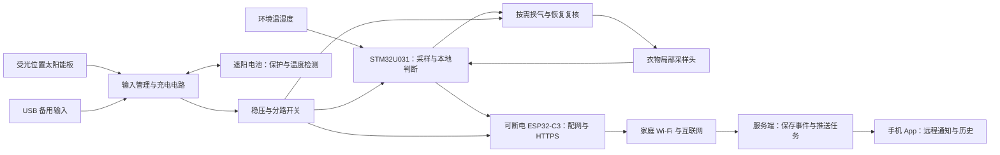

# 衣架式干燥监测：太阳能供电与远程提醒设计

版本 v0.2，2026-10-23。配套：[测量架构与验证方案](hanger-drying-architecture.md)。

已确认使用条件：阳台有阳光；家里有 Wi-Fi；用户离家后仍需收到手机提醒。本文是待验证的工程方案，没有硬件、光照或推送实测结果。功耗数值、时间、尺寸等级和验收目标均不是产品承诺。

## 1. 推荐架构与功能边界

采用 STM32 本地判断、Wi-Fi 按需联网、服务端推送、太阳能补能加电池储能。第一版监测一件衣物，重点测点放在较难干的部位；多个衣架不应共享一个局部探头后仍声称逐件判断。



设备不依靠手机在家，也不要求手机一直与衣架保持蓝牙连接。外网中断时本地监测和指示继续，远程提醒暂不可达，联网后按事件有效性补报。

不让云端逐秒判断干湿。上传状态、摘要和必要诊断信息即可；完整实验曲线在研究阶段用 USB 导出。

本方案保留 STM32 作为作品核心。双芯片有利于隔离测量与网络软件，但会增加 BOM 和调试工作；若未来只追求最低成本，可另行评估单 ESP32 完成全部任务。不能先验宣称双芯片一定更省电。若以后做多个衣架，也可比较 BLE 节点加常供电 Wi-Fi 网关的总成本与维护成本。

## 2. 结构和热设计

建议将系统分成三个位置：

- 太阳能板：衣架上方或阳台固定支架上，尽量不被衣服遮挡，角度可调。先评估标称 6 V、2 W 等级的小板，具体型号、面积、重量和固定方式待选。
- 主机、电池与环境参考探头：遮阳、避滴水，保留空气流通；参考探头与电池、充电器、无线模块分开，避免电子器件发热污染环境读数。
- 局部采样头：短线连到衣物厚处，传感器测空气。外壳挡直射光，开放气路不能用密封防水壳全部封住。

电池不贴太阳能板背面。充电需要电池温度检测，并按所选电芯的数据手册配置允许温度与电压；主机测得的空气温度不能替代电池温度。保护板不替代充电管理。外壳进水防护、透气和维护方式需要组合验证。

Wi-Fi 上报和风机工作可能引起热扰动。优先在一次测量完成后上报，下次测量前确认热影响已消退；不能假设无线模块断电后温度立即恢复。

## 3. 电子器件建议与边界

| 部分 | 第一轮选择 | 仍需确认的事项 |
|---|---|---|
| 主控 | NUCLEO-U031R8 验证，产品板用 STM32U031 | 引脚、存储余量、RTC、睡眠电流；调试板不能代表最终功耗 |
| 测量 | 两只 SHT45，后期评估 SHT40 | 热布局、匹配偏差、封装响应和高湿恢复 |
| 无线 | ESP32-C3 模块，通过 UART 与 STM32 通信 | 2.4 GHz 家庭 Wi-Fi、配网、TLS、启动及弱网能量 |
| 光伏 | 暂按 6 V、2 W 等级建模 | 实际工作电压、开路电压、温度变化、遮挡和玻璃后的输出 |
| 储能 | 单节 3.7 V 标称、1500–2000 mAh 锂电池作为候选 | 电芯允许充放电条件、实际可用容量、保护与 NTC、衣架承重 |
| 充电管理 | 评估 BQ25186 或功能相当方案 | 输入调节、电池温控、功率路径、充电散热与默认上电配置 |
| 电源轨 | 低静态电流稳压；无线和执行件可关断 | 低电量时仍满足无线峰值；关断时 GPIO 不反向供电 |
| 气窗 | 优先比较无需持续通电保持的位置机构 | 一次完整开合能量、寿命、噪声；普通舵机持续保持电流不应遗漏 |

BQ25186 官方资料给出 3–18 V 工作输入、线性充电、功率路径、电池温度检测和面向高阻源的输入电压管理。它适合作为候选，但不能把其输入调节等同于对任意太阳能板持续寻找全局最大功率点。配置需匹配板子的输出特性；线性方案也有热损耗。[TI 产品资料](https://www.ti.com/product/BQ25186)

例如输入端实际 6 V、电池约 4 V、充电电流 0.2 A 时，仅线性压差损耗就约 (6−4)×0.2＝0.4 W；这是示意工况，不能替代完整功率路径的热分析。若实测显示充电损耗限制性能，再比较开关式光伏充电方案。

线性充电器不能升压。弱光时还要确认太阳能板能提供高于电池及所需压差的工作电压；只有开路电压、没有带载电流的数据，不能证明能有效充电。

电路分为输入切换／防反灌、充电与储能、稳压、分路负载四层。太阳能和 USB 通过合适的电源选择电路进入充电器，不直接硬并联。单节电池电压可能低于 3.3 V：可使用合适的升降压，或明确工作截止电压及因此损失的容量。SYS 输出也不能未经核对直接接 3.3 V 器件。

Espressif 建议 ESP32-C3 的 3.3 V 电源供电能力不低于 500 mA，并提醒发射电流突变可能引起电源跌落。这是电源能力要求，不是平均功耗。电池、稳压器、开关、布线和去耦都要一起验证；避免无线发射与风机启动重叠。[官方硬件指南](https://docs.espressif.com/projects/esp-hardware-design-guidelines/en/latest/esp32c3/schematic-checklist.html)

## 4. 功耗模型：先按事件算，再取整机预算

统一用 Wh／天，不能将 mAh 直接当能量。以下是自定义产品板的假设，不适用于带常亮灯和调试器的完整开发板。每项应由电流积分实测替换。

| 项目 | 预算假设 | 间歇复核：36 次／天 | 频繁复核：144 次／天 |
|---|---|---:|---:|
| 主控、传感器、控制与静态耗电 | 合计平均 1 mW，全天 | 24 mWh | 24 mWh |
| 风机 | 0.2 W，每次 20 秒 | 40 mWh | 160 mWh |
| 气窗 | 完整开＋关共 0.1 J／次，不通电保持 | 1 mWh | 4 mWh |
| Wi-Fi | 平均 0.6 W，每次 6 秒，28 次／天 | 28 mWh | 28 mWh |
| 零星提示与其他动作 | 暂留 4 mWh／天 | 4 mWh | 4 mWh |
| 负载侧合计 | 相加 | 97 mWh | 220 mWh |
| 电池侧估算 | 除以暂定 85% 综合供电效率 | 114.1 mWh | 258.8 mWh |
| 加 30% 工程余量 | 再乘 1.3 | 148.4 mWh | 336.5 mWh |
| 便于规划的日预算 | 向上取整 | **0.15 Wh／天** | **0.35 Wh／天** |

36 次可以理解为只有需要时才主动复核；144 次相当于全天每 10 分钟复核一次。它们是两个比较工况，后者不是所有可能负载的上界。调度策略仍需服从测量有效性和提醒延迟。

Wi-Fi 的 28 次按 24 次小时摘要加 4 次状态事件估算。合并上传可减少次数；更多状态事件或失败重连会增加次数。6 秒须包含启动、入网、DHCP、DNS、TLS、上报和确认，不能只计发送几十个字节的时间。实际总时长可能远高于此。

30% 是工程余量，不允许据此无限重试。独立记录失败连接能量。若风机实际需要 40 秒，或者气窗必须持续通电，必须重新计算；不要为了满足预算缩短尚未验证的测量流程。

已用配套计算器检查两个敏感性情景：其余参数不变，若每天 56 次连接且每次 20 秒，间歇模式规划值变为约 0.40 Wh／天；若风机改为 0.4 W、每次 40 秒、每天 144 次，规划值变为约 1.10 Wh／天，1500 mAh 候选电池按同一模型只够约 3.5 天无光。这些仍是构造情景，作用是显示选型和弱网可能推翻原预算。

负载端模型：

```
E_load = P_base × 24
       + P_fan × t_fan × N_fan / 3600
       + E_vent_J × N_fan / 3600
       + P_wifi × t_wifi × N_wifi / 3600
       + E_misc
E_day = E_load / eta_dc × margin
```

P 单位 W，t 单位秒，E_load、E_misc、E_day 单位 Wh。静态负载先统一折算到负载侧；若实测已经是电池端全天积分能量，就直接用测量值，不能再次除以效率。充电损耗另列在收能侧，不重复扣除。

## 5. 太阳能能否覆盖日耗

```
E_solar = P_panel × H_equiv × eta_harvest
```

P_panel 为标称功率；H_equiv 为板面接收到的日辐照量折合到标准 1000 W/m² 的小时数，不是“看见太阳几个小时”；eta_harvest 暂取 0.60，合并温度、低照性能、充电与线路等影响。角度、遮挡、玻璃透射若已计入实际板面辐照量，不要再次重复扣除。没有辐照仪时，直接测每日进入储能／系统的净能量更有用。

| 2 W 板的假设 H_equiv | 按 60% 得到的日收能 | 对 0.15／0.35 Wh 日耗的含义 |
|---:|---:|---|
| 0.10 小时 | 0.12 Wh | 两种模式都要消耗电池储备 |
| 0.25 小时 | 0.30 Wh | 覆盖间歇模式，频繁模式仍有缺口 |
| 0.50 小时 | 0.60 Wh | 两种模式都有补充电池的余量 |
| 1.00 小时 | 1.20 Wh | 余量较大，但还受充电电流、温度与满电限制 |

因此，阳台有阳光支持做太阳能方案，但还不能推出永远免充电。先用 2 W 等级可调角度板验证，在目标阳台记录晴天、阴天、遮挡和电池温度。真正的长期能力还需覆盖冬季等不利季节；第一轮 7–14 天只用于发现明显问题。

2 W 板的收支平衡点分别是 0.15/(2×0.60)＝0.125 和 0.35/(2×0.60)≈0.292 等效小时／天。设计不能只贴着平衡点，还要留出阴天后补回电量的余量。

## 6. 储能与连续阴天

用名义电压和容量估算电池能量，暂以 70% 作为老化、温度、放电截止和保留电量合并后的可用比例；这不是某款电池的保证，也不再重复包含前面已计算的 DC 转换损耗。

```
E_usable = V_nominal × capacity_Ah × usable_fraction
dark_days = E_usable / E_day
```

1500 mAh、3.7 V、70% 对应约 3.885 Wh；理论上可支撑 0.15 Wh／天约 25.9 天，或 0.35 Wh／天约 11.1 天。这里只是模型结果；不据此标注实物续航。

建议先将“按目标工作模式连续 7 天无光仍完成任务”作为产品验收目标。按 0.35 Wh／天算需要 2.45 Wh 可用储能，对应约 946 mAh 名义容量；选 1500–2000 mAh 候选留出进一步余量，仍需实测验证重量、容量和温度条件。

恢复阴天消耗也要计算。若随后每天实际能收到 1.2 Wh，仍消耗 0.35 Wh，则每日可补回约 0.85 Wh，补回前述 2.45 Wh 至少需要约 2.9 个这样的日照日。电池接近满电时的充电限制还可能延长时间。

长期仿真用每日能量递推，达到储能上限时记录弃能，降到下限时记录供能缺口，不能把负能量裁成零后仍假装所有功能完成。日平均模型也看不到射频瞬时掉压和白天／夜间顺序，所以必须另做瞬态和夜间测试。

## 7. 低电量调度

| 状态 | 建议行为 | 不变的规则 |
|---|---|---|
| 储能充足 | 正常采样；接近干燥时复核；状态变化立即上报 | 不为“有太阳”无意义地多测 |
| 储能下降 | 延长非关键摘要间隔；仅保留必要复核 | 不降低判干阈值，不缩短未验证的必要恢复过程 |
| 储能很低 | 保存状态，尝试一次低电量提示，减少动作或暂停 | 若复核不足则显示待确认／监测暂停 |
| 达到工作截止 | 安全停止；满足更高恢复阈值后再启动 | 不在弱光下反复启动、入网、掉电 |

具体电压／荷电状态门槛在选定电芯、负载和电源后确定。电池端电压只能粗略反映余量；未做估算标定前，App 用高／中／低档和充电状态，不展示伪精确百分比。

节能收益优先来自减少无必要主动周期、取消气窗保持电流、避免弱网长时间连接、关掉板载常亮灯及高静态电流器件。最后再优化 MCU 指令级执行时间。

## 8. 通知协议：远程收到与设备省电同时满足

首版建议短时 HTTPS 上报，暂不维持长连接。STM32 负责状态和待发事件；ESP32-C3 负责 Wi-Fi、TLS 证书验证、网络时间和协议，不因省电关闭证书校验。无线模块断电前让 UART 引脚进入不会反向供电的状态。

正常流程：

1. STM32 连续有效复核得到“建议检查收衣”，记录不可重复的事件编号和当时质量等级。
2. 无线模块上电，连接家中 Wi-Fi，通过 HTTPS 提交当前快照和待发送事件。
3. 服务端在一次事务中保存事件与推送任务；已见过的事件只确认，不重复生成提醒。
4. 设备收到“已持久保存”的确认后结束这次通信，无需等手机真正收到。
5. 服务端推送任务交给合适的手机推送通道；App 收到后更新通知，打开时拉取最新状态。

“服务端已保存”“推送服务已接收”“手机显示了通知”“用户看过”是不同状态。能观测到哪一步就记录哪一步，不显示无法证明的“已送达”。

设备上报建议字段：

```
device_id, garment_session_id, event_id, state_version,
measured_at, monotonic_ms, clock_valid,
state, quality_grade, quality_reasons,
ambient_T, ambient_RH, local_T, local_RH,
battery_level_band, charging_state, energy_mode,
firmware_version, algorithm_version, next_report_due
```

event_id 应跨重启保持唯一；state_version 对同一晾衣批次单调递增。关键事件用带校验、掉电恢复和磨损控制的持久队列保存，不能每秒写 Flash。无有效实时时钟时保留顺序和时钟无效标记，不编造测量日期。设备重新绑定需要新的授权关系，服务器不能仅凭猜到 device_id 就接受上报或允许读取。

网络失败设置单次连接超时及每日重试能量上限。起始可试 1、5、15、60 分钟退避并加少量随机抖动，随后稀疏重试；这些间隔不是可靠性保证，最终根据弱网能量与可接受延迟确定。连续失败不能持续唤醒射频。

过时事件处理尤其重要：断网时曾经“可收衣”，后来又受潮或重新开夹，联网后先提交最新状态；较旧的收衣事件只进入历史，不再推送。可收衣提醒暂设 30 分钟有效期作为待验证起点；过期后重新确认再发，不把数小时前的状态当成当前状态。推送队列也设置有效期，并用状态版本淘汰旧任务。已经送达的旧通知用后续状态更新／撤销；无法撤回的通知需明确带测量时间。

## 9. App 和服务端怎样做

先做 Android 单平台，采用原生 Kotlin 与 Jetpack Compose；这是项目实现建议，尚未创建代码。服务端只需设备绑定、HTTPS 事件接口、事件存储和推送任务处理，不必第一版就做复杂物联网平台。

Android 会在 Doze 等状态限制 App 的后台网络访问，因此不能把“App 一直自己连服务器”当可靠收信方式。使用系统／厂商推送通道；Google 服务可用的设备可评估 FCM，其他环境按目标手机接入适用的厂商推送。[Android 官方说明](https://developer.android.com/training/monitoring-device-state/doze-standby)

例如小米提供开发者注册、启用推送、SDK 和服务端接口流程，但服务接入和消息类别存在审核。先验证自己的手机和账号能否接通所需通道，再扩大 App 功能；不能承诺尚未开通的服务一定可用。厂商服务端密钥只在服务端保存。[小米推送启用指南](https://dev.mi.com/xiaomihyperos/documentation/detail?pId=1542)

App 首版只显示：衣物状态及原因、最近测量时间、最近联网时间、充电与电量档位、简洁历史，以及配网／重新绑定。通知示例：“毛巾厚处的连续复核已满足收衣条件，建议检查收取。测量时间 16:20。”在完成充分验证前，不写“整件完全干透”。

默认每小时上报一份摘要，重要状态立即上报。远程打开 App 时展示最近的云端数据及其年龄；按需断电的 Wi-Fi 模块不能被云端随时唤醒。因此“刷新”不承诺秒级新测量，远程配置在下次设备联网时生效。需要实时查看时，另设有超时的调试模式并计入功耗。

断开联系超过预期上报时间和宽限期后，可提示“设备数据已过期”；服务端无法仅据此分辨路由器故障、家庭断网和设备没电。通知权限关闭或手机断网时也不承诺即时可见。验收需覆盖 App 关闭、锁屏和手机移动网络场景。

## 10. 候选创新点与比较实验

太阳能供电、Wi-Fi 和手机推送是实现产品的功能组合，不能单独据此声称技术首创。值得验证的是：在相近误报率、提醒延迟和覆盖率下，是否能用更少的主动测量和联网能量完成判断。

对比固定周期复核与“被动趋势筛选＋必要时主动复核”；后者必须在实际在线规则下运行，不能离线先知道何时干燥再挑选测量。还应比较恒定上传与事件上传。分别报告每日 Wh、有效复核次数、有效提醒数量、漏报／误报、延迟和无结果比例。

太阳能只改变可用能量，不直接提供衣物已经干燥的证据。面向能量的调度不得越过测量条件门槛。创新优势最终来自完整实验，不能用多装一个模块代替证据。

## 11. 实施顺序与验收

先把系统接口和验证计划定下来，分模块实测，不立即做一块包含所有未知项的 PCB。

| 阶段 | 做什么 | 可以判定通过的证据 |
|---|---|---|
| A 测量 | USB 供电，原方案双探头、可换腔体与基线对照 | 明确哪些条件下可判、哪些条件下不可判；主动测量确有收益 |
| B 通知 | 用模拟状态走完设备→服务端→手机链路，再接真实判断 | 手机离开家庭 Wi-Fi 仍能提醒；锁屏／后台可达；重发去重、过时事件不误推 |
| C 能量 | 记录睡眠、采样、风机、气窗、成功／失败联网的电池端波形 | 可把真实积分能量代入模型；峰值时不掉电；省电模式不误判干 |
| D 光伏 | 在目标阳台测板面输出、净收能、电池温度和遮挡影响 | 日能量收支明确；目标工作模式无光 7 天完成约定功能；恢复日照可充回储备 |
| E 集成 | 低功耗 PCB、热布局、外壳、排水和线缆 | 同时满足判断、联网、温度、能量和使用便利性要求 |

通知可先以“网络正常时，从本地状态确定到手机可见的 95 分位延迟不超过 60 秒”为待验证目标；另报干燥识别延迟和未送达次数。未送达样本不能从成功率分母里删掉。具体目标可在首轮测试后调整，必须在正式对比前冻结。

理论阶段尚未确定：采样腔与风机型号、判干阈值、天气和季节收能分布、电芯具体型号、推送通道资格及其后台到达表现。这些有明确的实验入口，不能通过计算提前消除。

计算工具：[energy_budget.py](analysis/energy_budget.py)；默认情景输出：[energy-budget.csv](analysis/energy-budget.csv)。运行 `python analysis/energy_budget.py --help` 查看可替换的假设。脚本仅为预算工具，不是测量仪器或完整电池模型。
